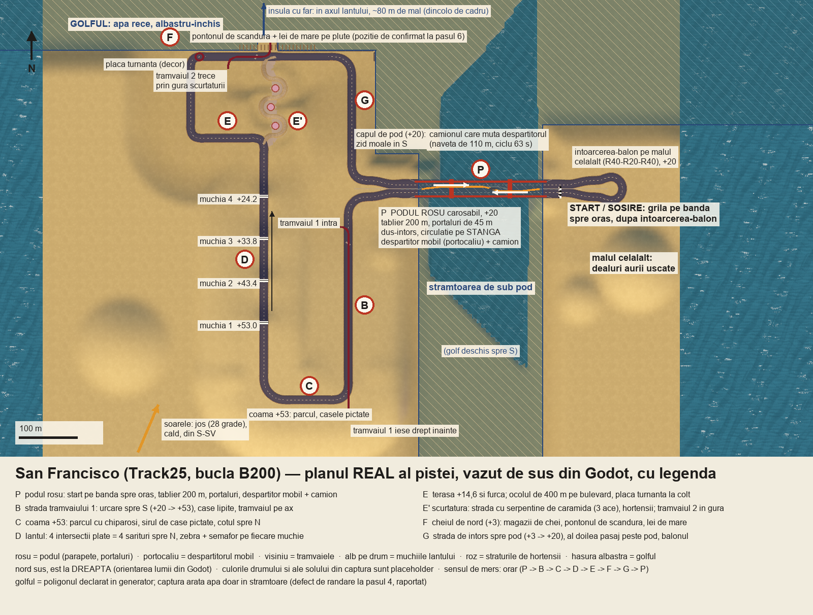
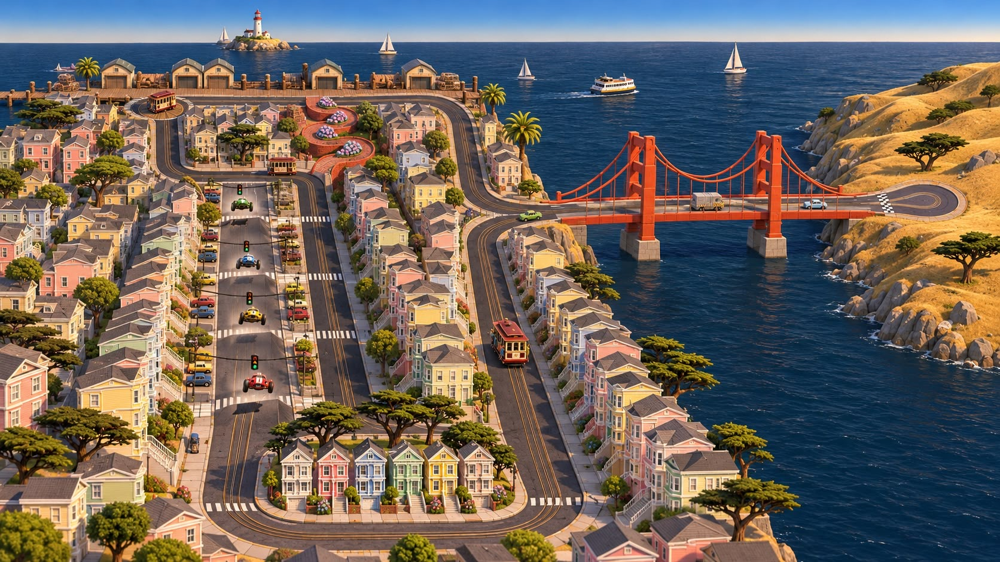

# Foaia de assets — San Francisco (`Track25`, temă `sanfrancisco`, bucla B200) — v0.2

Pasul 4 din `docs/track_briefs/san_francisco.md` §7, făcut pe 15 nov 2026, pe main 3c039143 (B200,
PR #733). Pista e încă placeholder gri; foaia spune **ce se modelează, pentru cine, unde stă și în
ce ordine**, ca pașii 7 (hero) și 8 (kituri, fundal, teatru) să poată porni din timp.

> **v0.2 (15 nov 2026): reconciliată cu diorama** (`img/sf_route/sf_diorama_v1.jpg`, §3.1) și cu
> pasul 6 (PR #735: serpentinele de cărămidă cu hortensii, pontonul de la x 40 la 120, cele 42 de
> mașini parcate ca `BumpProp`, golful reparat). v0.1 fusese scrisă înaintea dioramei. Cotele și
> contractele cu codul din §1 nu depind de dioramă: geometria rămâne cea din plan.

Briefurile Blender ale primului val (auto-conținute, pentru agentul extern care nu vede repo-ul):

| brief | piesă | stare |
|---|---|---|
| [`sf_cable_car.md`](sf_cable_car.md) | vagonul de cablu, ambele tramvaie | **primul de dat**: consumatorul îl primește fără cod |
| [`sf_red_bridge.md`](sf_red_bridge.md) | podul roșu carosabil, kit modular | al doilea; integrarea e date în generator, nu cod de motor |
| [`sf_painted_row_kit.md`](sf_painted_row_kit.md) | kitul casei de rând + soclul | pilotul (o casă) se poate da; cele cinci tente cer o decizie (§1.2) |
| [`sf_median_truck.md`](sf_median_truck.md) | camionul despărțitorului + blocul | se modelează oricând; intră în joc abia după codul din §1.5 |

## 0. Cum se citește

- **Coordonate:** de hartă, ca în `tools/gen_sf_route.py`: x spre E, y spre N, în metri; în Godot
  gx = x, gz = −y. Cotele sunt absolute (apa la 0).
- **Fracția de tur** e pe lungime (2.563 m), startul fiind linia de pe malul celălalt (`far1`).
- **Rol:** hero (unic, cu caracter), kit (modular, repetat), mobilier (mic, repetat), vegetație,
  fundal (`horizon_class` sau siluete dincolo de 250 m), teatru (viu sau mobil, fără coliziune).
- **Prioritate:** P1 = fără ea pista nu citește „San Francisco” sau un hazard rămâne cutie gri;
  P2 = identitatea unui POI; P3 = umplutură și teatru.
- **Triunghiurile** sunt orientative și se raportează, nu pică build-ul (CLAUDE.md). Contează
  repetiția: o piesă pusă de 300 de ori costă de 300 de ori.

## 1. Trecerea de contracte (brief §5.7)

Memoria `brief-cere-glb-cod-il-face-deja`: înainte de primul GLB, verdict din cod citit pe
consumatorul fiecărei piese. Trei verdicte posibile: **ARE CONSUMATOR**, **decor pur** (DecorManual,
tema are `decor: "none"`), **LIPSEȘTE COD** (cu ce anume).

| # | piesă | consumator | verdict |
|---|---|---|---|
| 1 | vagonul de cablu | `BusHazard` (moștenește `PathMover`) | **ARE CONSUMATOR.** Zero cod; o linie de date în generator |
| 2 | casele de rând pe pantă | `CityFill row_mode` (rândurile din spate), `DecorManual` (rândul din față) | **PARȚIAL.** Treptele de acoperiș ies fără cod; cele cinci pasteluri și soclul exact cer cod |
| 3 | cărămida serpentinelor | cheile de temă `branch_texture` / `branch_tint` | **REZOLVAT la pasul 6**, fără GLB (v0.1 spunea greșit „lipsește cod”, §1.3) |
| 4 | golful / pontonul | `SeaRespawn` (automat), `ViaductNet`; `custom_wood_deck_ranges` | **REZOLVAT**: plasa există, scândura și golful făcute la pasul 6 |
| 5 | camionul și blocul despărțitorului | `MovableMedianHazard` | **LIPSEȘTE COD**: hazardul n-are export de model |
| 6 | podul roșu | nimic azi: cutii generate în `Pod/` | **decor pur + date în generator**; coliziunea rămâne a jocului |
| 7 | mașinile parcate | `BumpProp` (`opts["max_footprint"]`, `["max_height"]`) | **REZOLVAT la pasul 6**: 4,5 m în plan, 70 kg; duba prin `max_height` (în lucru) |
| 8 | fundalul | `horizon_model` / `horizon_rings` din temă | **ARE CONSUMATOR** (date în temă) |
| 9 | leii de mare, pescărușii, papagalii | `FlockProp` | **ARE CONSUMATOR**: un mesh, un material |

### 1.1 `BusHazard` acceptă un model cu un singur corp și `model_yaw`? — DA

- `scenes/props/path_mover.gd:53` `model: PackedScene`, `:65` `model_node`, `:69` `model_scale`,
  `:76` `model_yaw`. `_build_model()` (`:285–320`) instanțiază GLB-ul, îl rotește cu `model_yaw`,
  aplică clasele și **măsoară cutia de coliziune pe AABB-ul modelului** (`Track.model_aabb`,
  `scenes/tracks/track.gd:7116`).
- `scenes/hazards/bus_hazard.gd:218–244`: `_build_body` citește cutia măsurată și croiește pe ea
  botul oblic (`:252`) și zona de ghiont. Cu model, botul e invizibil (`:282–293`).
  `_ground_pitch` (`:361`) folosește jumătatea de lungime a cutiei.
- **Contractul care decurge:** AABB-ul GLB-ului **este** corpul fizic. Placeholderul de azi are
  2,5 × 3,2 × 8,5 m (`tools/gen_sf_route.py:1408`, `TRAM_BODY`), iar toate cifrele de contact de la
  pașii 1c, 5 și 2b sunt măsurate pe el. Un călător care iese în lateral cu 20 cm lățește corpul cu
  40 cm și mută măsurătorile. De aceea briefului i se cere AABB exact 2,5 × 3,2 × 8,5.
- **Integrarea:** în blocul de tramvaie al generatorului (`gen_sf_route.py:1630–1640`), `model =
  ExtResource(...)` în loc de `placeholder_color`; `body_size` rămâne doar ca rezervă.
  Față = −Z, deci `model_yaw = 0`. După integrare se reface lotul ProbeRace al tramvaielor
  (`tools/sf_route_race.sh`): contactul pe întâlnire trebuie să rămână în banda de la 2b (1–5 %).

### 1.2 `CityFill row_mode` știe pante cu soclu? — PARȚIAL

Citit în `scenes/props/city_fill.gd`:

- `_generate_rows` (`:442–548`) pune fiecare casă la **cea mai joasă** din cinci cote de teren,
  minus `sink_m` (0,3 m, `:53`), și o respinge dacă diferența dintre cote depășește `max_step_m`
  (2,5 m, `:51`). Eșantioanele sunt la ±3,2 m pe **axele lumii**, nu pe ale casei (`:528`).
- Nu există noțiunea de soclu. Pe pantă, latura de deal a casei intră în teren cu până la ~1,8 m
  (28 % pe 6,4 m), iar latura de vale stă la cotă.
- **Treptele de acoperiș ies fără niciun cod:** fiecare casă e la cota ei, deci acoperișurile
  coboară cu panta. Ce lipsește e soclul vizibil pe latura de vale. Kitul îl dă ca **fustă
  dreptunghiulară de 2,4 m sub podea**, pe care terenul o taie singur în pană (§ `sf_painted_row_kit.md`).
  Cu `CityFill` așa cum e azi, fusta stă sub teren (casa e la cota de jos). Ca fusta să se vadă,
  e nevoie de **o opțiune de o linie**: casa la cota de SUS (`hmax`), cu fusta acoperind diferența.
  Pentru rândurile din spate (> 40 m de drum, `min_road_m`, `:49`), unde se văd mai ales
  acoperișurile, merge și fără ea.
- Unghiurile cartierelor sunt aleatoare (`row_angles_deg`, `:114`), nu urmează strada. Pentru
  rândul din față asta nu contează: el e `DecorManual`, așezat de generator.
- **Cele cinci pasteluri: LIPSEȘTE COD.** `CityFill` cunoaște doar două tente pe model (deschis /
  indigo, `:44`, `:215–233`, `:569–573`), legate de `blue_lime_indigo` din Jodhpur. La fel
  `WorldProp`, cu metadata `indigo` (`scenes/props/world_prop.gd:3646`). Pentru cinci pasteluri pe
  aceeași casă trebuie generalizat: o listă de clase de perete (`sf_clapboard`, `_pink`, `_blue`,
  `_mint`, `_butter`) cu ponderi în `CityFill`, plus o metadata `wall_class` pe instanțele din
  `DecorManual`. **Alternativa fără cod:** câte un fișier GLB per pastel (aceeași geometrie, alt
  nume, clasa legată de nume în `CLASSES_BY_MODEL`). Costă de 5 ori fișierele și leagă culoarea de
  formă în tabel, nu în joc. **Decizia e a dezvoltatorului**; kitul se modelează la fel în ambele
  variante, deci nu blochează pilotul.
- Rândul din față (≤ 40 m de drum) are coliziune. Hull-ul convex implicit al `WorldProp`
  (`world_prop.gd:60–96`) ar include bovindoul, adică un zid invizibil la 0,9 m în fața garajului,
  pe trotuar. Coliziunea rândului din față o scrie deci generatorul, ca cutie pe planul fațadei
  (tiparul `Corp_<n>` din `tools/sf_loc_decor.gd`), cu `coliziune = "none"` pe GLB. `WorldProp`
  nu citește proxy-uri `_col` din GLB, deci kitul nu le livrează.

### 1.3 Suprafața ramurii primește `road_tint` separat? — DA, și textura (corectat în v0.2)

- `scenes/tracks/track_branch.gd:127–133`: fiecare ramură are `surface` (THEME / SAND / DIRT_ROAD /
  GRAVEL / DECK) și **`tint` propriu**, independent de `road_tint` din temă (`track.gd:11889`).
- **v0.1 spunea greșit că lipsește cod.** Tema are de mult cheile `branch_texture` și `branch_tint`
  (citite la `track.gd:10999`; Alpii și altele le folosesc). **Pasul 6 le-a folosit:** dala
  `roof_tiles` a clasei `sf_brick`, tentată cărămiziu, pe rețeta GRAVEL. Coliziunea și terenul au
  rămas neschimbate. **Nu se comandă GLB pentru carosabilul serpentinelor.**
- Zidurile joase de cărămidă ale straturilor de hortensii și fațadele de pe exteriorul acelor sunt
  geometrie generată (`SerpentineGri/SerpStraturi`, `SerpFatade`). Vizualul lor se face tot din
  generator, cu clasa `sf_brick` și cu casele kitului. **Nu se comandă GLB nici pentru ele.**
  Hortensiile de pe straturi sunt azi sfere placeholder (`SerpentineGri/Hortensii`, `MultiMesh`):
  le înlocuiește V3.

### 1.4 `RespawnZone` pe golf sau plasa de mare? — plasa există; pontonul e făcut

- `track.gd:8294` construiește automat `SeaRespawn` pe temele cu lagună: o cutie de la apă − 1,2 m
  în jos, pe toată întinderea (`track.gd:9910–9924`). Sub tablier lucrează `ViaductNet`
  (`track.gd:15182`). **Nu se adaugă niciun `RespawnZone`.**
- **Pontonul (pasul 6):** x 40 → 120 pe cheiul de nord. Carosabilul are scândura clasei `wood`
  (export nou `custom_wood_deck_ranges` pe `TrackFromPath`). Spre golf e o rapă-cornișă, cu stâlpi
  de amarare moi de 0,5 × 0,8 × 0,5 m, la 6 m unul de altul, de la x 52. **Latura dinspre apă a
  pontonului rămâne deschisă**: golurile dintre stâlpi sunt mecanica (căderea ≈ 2 s).
- **Golful (defectul găsit la v0.1) e reparat la pasul 6:** fundul lagunei ieșea peste apă, fiindcă
  pe B200 media șoselei urcase. Generatorul scrie acum `lagoon_depth`.

### 1.5 `MovableMedianHazard`: camionul și blocul — LIPSEȘTE COD

- `scenes/hazards/movable_median_hazard.gd:208–226`: blocurile sunt un `BoxMesh` de
  `block_len + 0,1` × `block_height` × `block_width` (3,1 × 0,95 × 0,6) într-un `MultiMesh`, cu
  transformul ridicat la `block_height / 2` (`:293`). Coliziunea e separată: 3,15 × 1,3 × 0,6.
- `:297–335`: camionul e o cutie de `truck_size` (2,6 × 3,2 × 10,0; lungimea pe +X local) plus o
  „cabină” placeholder. Se întoarce cu 180° când schimbă sensul (`:344`).
- **Nu există `truck_model` și nici `block_mesh`.** Cod lipsă: un export de model pentru camion
  (rotit −90°, fiindcă hazardul merge pe +X local, iar GLB-ul are fața pe −Z), un export de mesh
  pentru bloc, plus decalajul de origine (GLB cu originea la bază, nu la centru). Cutia de
  coliziune și citirea AI-ului rămân pe `truck_size`, deci GLB-ul trebuie să încapă exact în ea.
- Zidurile moi din S (`Pod/CapS`, `gen_sf_route.py:1733`, 80 m × 4,3 m × 0,6 m pe axă) sunt azi
  cutii gri. Vizualul lor poate fi același bloc, pus în rând de generator.

### 1.6 Podul roșu — nimic nu-l încarcă azi

- `Track25.tscn:740–860`, scris de `gen_sf_route.py:1700–1760`: parapete (`StaticBody`, cutii
  224 × 1,2 × 0,5 m, fața interioară la |z| = 12,2), evazări (10 m la 20°), picioarele portalurilor
  (3 × 75 × 3 m, **cu coliziune**, de la −10 la +65), traversele (2,4 × 2,4 × 32 m la +35 și +59,
  fără coliziune), zidurile moi din S, despărțitorul. Carosabilul e banda `TrackFromPath`, iar golul
  de sub ea e o rapă-viaduct.
- **Verdict:** coliziunea rămâne a jocului, exact cum e. GLB-ul podului e **pur vizual**: nicio
  coliziune în fișier și nicio suprafață pe care rulează roata. Integrarea e în generator (date):
  piesele instanțiate sub `Pod/Model` ca noduri `DecorManual` cu `metadata/coliziune = "none"`,
  iar meshurile `*M` gri scoase (cutiile de coliziune rămân).
- Ce poate strica GLB-ul, deci ce interzice briefului: geometrie în gabaritul carosabilului
  (|z| < 12,2 până la +13,8 peste tablier), parapete vizuale mai groase decât cutia de coliziune,
  picioare mai late decât cutiile lor (3 × 3 m), orice sub +13,8 între picioare.

### 1.7 Mașinile parcate și `BumpProp` — REZOLVAT la pasul 6 (15 nov 2026)

`scenes/props/bump_prop.gd:29–30`: `MAX_FOOTPRINT_M = 2,0`, `MAX_HEIGHT_M = 1,8`. La `:86–88`,
`wrap()` refuză orice piesă mai mare, iar `WorldProp` cade pe hull static. O mașină parcată (4,2 m)
devine deci zid. Opțiunea `mass` există (`:64–66`, `:125`; tuk-tuk-urile din Angkor), dar plafonul
de mărime nu se poate ocoli. Brief §3 („masa aleasă ca Autobuzul să le arunce”) **cere cod**: o
opțiune de mărime per model (`opts["max_size"]`). Plafonul de 64 de corpuri pe pistă (`:34`)
rămâne. **Relevant pentru pasul 6**, care pune acum mașinile parcate.

**Rezolvat (PR #735, pasul 6):** `opts["max_footprint"]` per piesă; mașina parcată cere 4,5 m și
cântărește 70 kg (decizia dezvoltatorului, calibrată: ~0,57 s pe lovitură la 30 m/s). Plafonul de
**înălțime** de 1,8 m se ridică tot per piesă (`opts["max_height"]`, decizia dezvoltatorului din
15 nov 2026), ca duba din M1 să fie împinsă, nu zid static.

### 1.8 Fundalul, stolurile, decorul manual

- Tema `sanfrancisco` folosește azi `carrara_horizon.glb` cu zero inele (`track.gd:4591–4593`).
  Un `sf_horizon.glb` cu variantele ca **copii direcți ai rădăcinii** se leagă prin `horizon_rings`
  (`picks` pe nume, ca la Carrara, `track.gd:4423–4430`). Inelul stă sub `fog_end` 360.
- `FlockProp` (`scenes/props/flock.gd:19–23`) ia **un mesh și un material**: leii de mare cu pluta
  lor, pescărușii și papagalii sunt fiecare un singur nod pe atlas.
- Tema are `decor: "none"`: tot decorul e `DecorManual` (scris de generator sau pus de mână) sau
  `CityFill`. Clasele de material se leagă de nume în `world_prop.gd` (`CLASSES_BY_MODEL` /
  `CLASSES_BY_THEME`). Intrarea `sanfrancisco` nu există încă: o face coordonatorul la integrare.

## 2. Bugetul de materiale

**Măsurat azi (`probe_decor --track=25`, 15 nov): 24 de materiale**, plafon 38. Lista lor
(sondă temporară, nu e comisă):

| grup | materiale | ce sunt |
|---|---|---|
| sistemul pistei | **12** | carosabilul (shader), umerii de beton, pietrișul ramurii, trei de marcaje (alb, negru, crem), un ton de margine, urmele de roți, terenul (shader), apa (shader), zidul de chei, atlasul lumii (chevroanele) |
| **placeholdere care dispar** | **12** | tramvaiele (3 materiale pe fiecare instanță: 6), parapetele gri, portalurile roșii, blocurile, camionul (2), serpentinele gri |

Cu GLB-urile pe atlas, cele 12 placeholdere devin **zero** materiale noi: vagonul, camionul,
blocul și podul (oțel `KERB_RED` 7, beton `CONCRETE` 8) cad toate pe atlasul lumii, deja numărat.

**După pasul 6: 26** (`probe_decor --track=25`, raportat în PR #735). S-au adăugat scândura
pontonului (+1, deja în proiecția de mai jos) și materialul sferelor de hortensii (+1,
placeholder; V3 îl înlocuiește cu tenta de atlas din proiecție). Mașinile parcate sunt pe atlas
(0). Piesele noi din diorama (§3.1: arbori de stradă, grădinițe, palmieri, bolovani, scări) sunt
toate pe atlas sau pe clasele de vegetație deja numărate, deci **proiecția nu se schimbă**.

**Proiecția pistei terminate:**

| ce intră | + materiale | note |
|---|---|---|
| sistemul pistei (măsurat) | 12 | |
| cele cinci pasteluri `sf_clapboard*` | +5 | o tentă = un material, ca albastrul Jodhpurului |
| cărămida (`sf_brick`) pe ziduri și pe carosabilul ramurii | +1…2 | două dacă materialul benzii e distinct de cel al obiectelor |
| scândura (pontonul, magaziile) | +1 | clasa `wood` (există) |
| vegetația: coroană punctată + frunze, hortensii (`atint:`) | +3 | chiparoșii, platanii, palmierii pe aceleași două; hortensiile cu tentă de atlas |
| zebrele și semnele pe carosabil (decal) | +0…1 | 0 dacă refolosesc materialul de marcaj alb |
| fundalul (`sf_horizon`) | +0…1 | 0 pe atlas, 1 dacă primește o clasă |
| apa a doua (strâmtoarea / golful), dacă devine stil separat | +0…1 | |
| **total** | **~23–27** | **plafon 38**, rezervă ~11 |

**Podul carosabil nu schimbă bugetul**, dacă rămâne pe atlas: oțelul roșu e un slot, nu o clasă.
Singura tentație care l-ar costa e o clasă de „oțel vopsit” pentru textura fețelor mari (+1). Se
decide pe captură, nu preventiv. Estimarea din brief §6 (~27) se confirmă, iar podul nu o mișcă.

**Axa care contează pe iPhone e numărul de obiecte** (memoria `iphone-plafon-multimesh`, bugetul de
2.500 de MultiMesh-uri). `CityFill` face cel mult 3 buffere pe model și pe celulă. Cu 7 modele de
casă și celule de 125 m (~36 pe pistă), plafonul teoretic e ~750. De măsurat cu
`MeshForest.mmi_count` / ProbePerf la integrare.

## 3. Planul de sus adnotat și zonele

`img/sf_route/sf_plan_adnotat.png` (captura reală de sus, legenda din `tools/annotate_sf_plan.py`).
Nord sus, est la dreapta.

| zonă | frac | cote | ce stă acolo (piesele din §5) |
|---|---|---|---|
| **P** podul, spre oraș (start) | 0.00–0.11 | +20 | podul (H1); despărțitorul, camionul și blocurile (H3); linia de start; balonul pe malul celălalt cu dealuri aurii (F2) și bolovani gri (N3); palmieri la capul de pod (V2) |
| **B** strada tramvaiului 1 | 0.11–0.26 | +20 → +53 | rânduri de case pe ambele părți (K1), tramvaiul 1 (H2); 12 mașini parcate în două grupuri pe fiecare parte (M1, pasul 6); arbori de stradă (V4); scări publice între rânduri (N1); poarta pe o stradă laterală de E (H5); felinare (M9) |
| **C** coama | 0.26–0.33 | +53 | **șirul de case pictate pe latura de N a brațului, cu fața spre S** (K2, recomandarea din §3.1), cu grădinițe în față (N2); parcul cu chiparoși în spatele lor (V1) |
| **D** lanțul | 0.33–0.49 | +53 → +14,6 | rânduri în trepte (K1); semaforul pe braț la fiecare muchie (M2); 30 de mașini parcate perpendicular (M1, pasul 6; niciuna în primii 45 m după muchie); arbori de stradă pe trotuarul de E (V4); mobilier (M3–M6) |
| **E / E′** terasa, ocolul, serpentinele | 0.49–0.65 | +14,6 → +3 | casele ocolului (K1); placa turnantă cu un vagon parcat pe ea, la colțul de NV (H4); cărămida și zidurile (cod, pasul 6) cu hortensiile (V3); palmieri pe terasă (V2); grădina din fața casei de la intrare, retrasă la 4 m (N2); tramvaiul 2 în gură (H2) |
| **F** cheiul de nord | 0.65–0.68 | +3 | magaziile pe piloni, pe latura apei **doar la V de peticul tramvaiului 2** (H6); pontonul x 40 → 120 (pasul 6) cu latura apei deschisă și stâlpii moi (M7); lăzile și capcanele pe latura de S (M8); leii de mare (T1); palmieri la capete (V2) |
| **G** strada de întors | 0.68–0.78 | +3 → +20 | case pe latura de V (K1), palmieri pe latura apei (V2), capul de pod |
| **P′** podul spre larg, balonul | 0.78–1.00 | +20 | podul (H1), insula cu far și, de pe tablier, velele și feribotul în golf (F1, T3) |

### 3.1 Verdictul pe dioramă (v1, 15 nov 2026)

`img/sf_route/sf_diorama_v1.jpg`, generată de dezvoltator din promptul din brief §9, peste
`sf_plan_adnotat.png`. Am verificat-o pe plan, punct cu punct. **Geometria rămâne cea din plan.**
Diorama e referință pentru atmosferă, paletă, scara pieselor în cadru și inventar, nu pentru
cote și nici pentru forma podului.

**Ce adoptăm:**

| ce arată diorama | e în plan? | ce înseamnă în foaie |
|---|---|---|
| podul la E, balonul în formă de lacrimă și linia în carouri pe malul celălalt | da | confirmă H1 și startul. **Doar culoarea, scara în cadru și poziția**: vezi „ce NU adoptăm” |
| malul celălalt: dealuri aurii cu **bolovani gri** la apă | da (`Peaks/MalulCelalalt*`) | F2 confirmat; **N3, bolovanii, intră nou** (P3, refolosire) |
| D la stânga: patru semafoare atârnate și mașini parcate perpendicular | da | M2 rămâne **P1** (telegraful muchiilor); M1 făcut la pasul 6 |
| insula cu far **în axul lui D** | da (§2.0, F1) | F1 confirmat P2 |
| serpentinele de cărămidă cu 3 ace și straturile de hortensii, între terasă și chei | da | confirmă E′ (pasul 6) și V3 |
| un vagon pe **placa turnantă rotundă din colțul de NV** | da (placa e decor din 13 nov) | H4 urcă: placa **plus un vagon parcat** pe ea, refolosind `cable_car.glb` ca decor static, **în afara carosabilului** |
| un debarcader cu magazii cu fronton și lăzi pe tot cheiul de nord | parțial | H6 rămâne P2, cu 4–5 magazii, dar **doar la V de peticul tramvaiului 2** (x −100 → −15). La x 40 → 120, latura apei a pontonului rămâne **deschisă**: golurile dintre stâlpi sunt mecanica pasului 6. Lăzile (M8) stau pe latura de S |
| soarele în spatele camerei, golful albastru-închis, cinci pasteluri, case de 2–3 niveluri | da (§4 din brief) | confirmă paleta și regula de înălțime |
| **cele șase case pictate de pe coamă, pe latura de N a drumului, cu fața spre S, luminate din față** | — (decizia 3 era deschisă) | **răspunsul la decizia 3: varianta (b), propusă ca recomandare** (§7) |

**Casele pictate, ce înseamnă în joc.** Șirul stă pe latura de N a brațului coamei
(x ~40 → 110, fațadele la y ≈ −121), cu fața spre stradă și spre soare. Pe brațul ăsta fațadele
au N·L ≈ 0,86 (tabelul de lumină de la 2b), deci sunt cele mai luminate de pe pistă. Pe mașină:
- urci spre S pe strada tramvaiului și vezi șirul din spate și din lateral, peste acoperișuri;
- **frontal, în 3/4, doar la ieșirea din colțul de sus** (R24, din S spre V): șirul e în
  dreapta-față, la ~40–60 m, cu fețele spre tine;
- pe brațul de 84 m (~3 s) îl ai în dreapta, razant, ca pe orice rând de la stradă;
- după virajul R36 spre N rămâne în spate.

Varianta (a), contra-lumina de la capătul urcării, ar fi dat vederea frontală pe toată urcarea,
dar cu fațadele în umbră. Diorama arată de ce (b) e mai bună: casele pictate sunt despre culoare,
iar culoarea cere soare. În spatele lor (la N) stă parcul cu chiparoși, iar în față au grădinițe
(N2).

**Ce NU adoptăm, și de ce:**
- **Forma podului.** Turnurile din dioramă (art-deco, cu panouri adâncite, picioare în trepte,
  silueta) sunt **prea aproape de podul real**. `sf_red_bridge.md` rămâne generic și robust și
  spune explicit că diorama nu e referință pentru forma turnurilor. **Am corectat și brief-ul:**
  v0.1 cerea caneluri verticale, picioare în trepte și panouri de portal în trepte, adică exact
  limbajul podului real. Acum cere picioare cu o singură îngustare continuă, rosturi orizontale de
  tablă, traverse simple și un singur X gros între ele.
- **A treia stradă N–S** între D și B (cu un vagon pe ea): în plan nu există. Se ignoră.
  Între lanț și strada tramvaiului sunt rânduri de case și parcul.
- **Relieful aproape plat** (fără socluri în trepte, urcarea pe B fără pantă vizibilă). Geometria
  e cea din plan (+20 → +53, 28 % pe lanț), iar soclurile rămân în kit (K1).
- **Chiparoșii ca umbrele plate.** Diorama îi face coroane-disc, ca pinii de umbrelă. Rămâne
  silueta din brief: chiparos de Monterey, **aplecat de vânt, asimetric, în pâlcuri dese stratificate**,
  cu trunchi scurt și gros, adesea ramificat. Motivul: discul plat pe trunchi subțire e silueta
  salcâmilor din Serengeti, deci două piste ar ajunge să citească la fel. Din dioramă luăm doar
  straturile orizontale ale coroanei.
- Duba gri de pe tablier e camionul despărțitorului desenat ca furgonetă. `sf_median_truck.md`
  rămâne cum e (utilaj cu tunel, două cabine).

**Ce intră nou în inventar** (§5):

| din dioramă | id | decizie | prioritate / val | buget |
|---|---|---|---|---|
| arbori de stradă cu coroană rotundă, pe trotuare, între case | **V4** (era P3) | da. Pe străzile N–S doar pe **trotuarul de E** (umbra de la soarele din S-SV cade spre NE, deci de pe trotuarul de V ar intra ~1 m pe carosabil). Niciunul în primii 45 m după o muchie. Contractul „≥ 80 % din lanț la soare” se remăsoară cu `ProbeSfLight` | **P2 / val 2**; întâi refolosire | ~800 tri, ~60–90 de instanțe, `trunk` |
| scări albe publice între rânduri, pe pante | **N1** | da, puține: 3–4, în golurile dintre rânduri pe B și pe flancul de E spre golf | P3 / val 3 | ≤ 400 tri pe tronson; balustrade ≥ 0,08 m |
| jardiniere și grădinițe cu gazon în fața caselor pictate | **N2** | da: modul de 7 × 3 m, servește și casa de la intrarea în serpentine, retrasă la 4 m (pasul 6) | **P2 / val 2**, cu K2 | ≤ 400 tri, fără coliziune |
| palmieri la serpentine și la capul de pod | **V2** (era P3) | da: capul de pod (în afara virajelor), terasa, capetele cheiului. Nu pe lanț | **P2 / val 2**; întâi refolosire | — |
| bolovani pe malul celălalt | **N3** | da, refolosire, gri, la apă și pe marginea balonului, la ≥ 3 m de carosabil | P3 / val 3 | — |
| feribot și vele, doar fundal | **T3** | rămâne cum era: fără gameplay, `PathMover` fără coliziune pe apă | P3 / val 3 | — |

## 4. Tabelul de frustum

Camera de joc: 10 m sus, 12,5 m în spate, 28,7° în jos, FOV vertical 68° (orizontal ±50° la
16:9), `FAR_PLANE` 380 m. Pâcla temei începe la 170 m (`fog_begin`) și închide la 360 m
(`fog_end`). La distanța `d` cadrul vede cel mult **10 + 0,093·d m** peste cota drumului.
Calculul e geometric, pe coordonatele din generator (scriptul e în scratchpad, nu e comis).
Azimutul e față de direcția de mers: + la stânga, − la dreapta.

| punctul (mașina, direcția) | ce e în cadru | la ce distanță | cât se vede din înălțime |
|---|---|---|---|
| **1. grila pe pod** (530, 222), spre V | portalul E (x 420) pe ax; portalul V (x 320); tablierul; capul de pod V | 123 / 223 / 173 / 309 m | până la +21 m peste tablier la portalul E, +31 m la cel V: **picioarele și traversa de jos (+15) se văd, cea de sus (+39) nu** |
| **2. mijlocul tablierului** (370, 222), spre V | parapetele și despărțitorul (0–60 m), camionul, portalul V; capul de pod; baza străzii tramvaiului | 14–60 / 63 / 149 / 242 m | portalul V iese din cadru pe sus la < 60 m: **se trece pe sub traversa de jos** |
| **3. strada tramvaiului** (144, 60), spre S | rândurile de case din față (0–60 m), tramvaiul pe ax, colțul de sus, parcul de pe coamă | 0–60 / 20–180 / 180 / 247 m | casa de 10–13 m intră întreagă de la ~0 m |
| **4. brațul coamei** (90, −132), spre V | parcul (dreapta-față), case pictate; prima muchie la stânga, la marginea cadrului | 51 / 167 m | |
| **5. prima muchie** (0, −2), spre N | muchia 4 și terasa în ax, primul ac al serpentinelor, baza străzii tramvaiului (stânga), capul de pod (stânga, la margine) | 230 / 314 / 351 / 245 / 337 m | totul dincolo de 170 m e în pâclă; **podul nu se vede din față** (decizia B200) |
| **6. muchia 4** (0, 214), spre N | terasa, primul ac, cheiul, placa turnantă, colțul de NE, **insula cu far în ax** | 98 / 136 / 252 / 275 / 280 / 344 m | insula la limita pâclei: siluetă |
| **7. furca** (0, 300), spre N | primul ac, cheiul, placa turnantă, colțul de NE, insula | 52 / 166 / 200 / 205 / 258 m | insula clară ca siluetă |
| **8. cheiul de nord** (0, 454), spre E | colțul de NE; capul de pod (stânga) | 132 / 334 m | portalurile, la 400–490 m, sunt dincolo de planul îndepărtat |
| **9. strada de întors** (150, 390), spre S | baza străzii tramvaiului; capul de pod; muchia 4 (dreapta); portalul V la marginea din stânga | 219 / 193 / 239 / 243 m | portalul până la ~+40 (traversa de jos) |
| **10. podul spre larg** (270, 235), spre E | tablierul; portalul V (se trece pe sub el); portalul E; malul celălalt | 0–113 / 63 / 163 m | ca la 1–2 |

**Ce rezultă pentru modelare:**

- **De aproape (LOD0 contează, ≤ 60 m):** casele rândului din față, mașinile parcate,
  mobilierul, semafoarele, vagonul (când îl depășești), blocurile și camionul, parapetele,
  picioarele portalurilor și traversa de jos, straturile de hortensii, magaziile și pontonul.
- **La distanță medie (60–170 m, clar):** traversa de jos și cablurile care urcă, rândurile din
  blocurile următoare ale lanțului, tramvaiul în față pe urcare, placa turnantă de pe muchia 4.
- **Doar siluetă (170–360 m, în pâclă):** dealurile de pe malul celălalt, insula cu far,
  portalurile văzute de pe strada de întors, rândurile din `CityFill`, parcul de pe coamă văzut de
  pe urcare, orașul de turnuri de pe inel.
- **Partea de sus a portalurilor (+39…+45) aproape nu intră în cadru:** de pe tablier doar de la
  ≥ 310 m, adică în pâclă. Identitatea podului stă în **primii 30 m ai turnului** (picioarele în
  trepte, traversa de jos cu panoul ei) și în **cablurile groase care urcă oblic și ies din cadru
  pe sus**. Briefului podului i se spune să pună detaliul acolo.
- **LOD obligatoriu:** podul (văzut de la 14 m la 330 m), casele (sute de instanțe, plus
  `shadow_proxy`), vagonul (văzut la 180 m pe urcare), camionul. Pe piesele importate ca GLB,
  LOD-urile le generează importul. Dacă integrarea le coace într-un `MultiMesh`, se poartă cu
  `MeshCpu.surface_lods` (CLAUDE.md).
- **Fără LOD apropiat (doar siluetă):** inelul de fundal, insula, dealurile, turnurile orașului.

## 5. Inventarul

Calea: `assets/models/sanfrancisco/{structures,buildings,vehicles,props,plants,animals,effects}/`.
Sloturile sunt cele din `scripts/palette.gd`. Toate cele 32 sunt definite, iar `verify_glb.py`
acceptă 0–13 și 17–30; 31 (`FLAMINGO_PINK`) cere `--allow-slots=31`. Nicio piesă nu folosește
14–16 (accentele mașinilor). Pentru fiecare piesă: nume, rol, unde, consumator, dimensiuni,
culoare, coliziune, LOD și triunghiuri orientative, prioritate și val.

### 5.1 Hero

| id | piesă | unde | consumator | dimensiuni | culoare | coliziune | LOD / tri | prio / val |
|---|---|---|---|---|---|---|---|---|
| **H1** | **`sf_red_bridge` (kit de 7–9 GLB-uri)**: turn-portal, segment de tablier de 8 m, parapet de 8 m, evazări, cablu principal, cablu lateral, ancoraj; opțional trotuarul exterior și felinarul | P / P′, 0.00–0.11 și 0.78–1.00; axa la y 228,6, tablierul x 270–470, portalurile la x 320 și 420 | generatorul (`Pod/Model`, `DecorManual`, `coliziune = none`); §1.6 | tablier 200 m × 32,8 m; portaluri de 45 m peste tablier, picioare 3 × 3 m la \|z\| 14,5, traverse cu fundul ≥ +13,8; parapet 1,2 × 0,5 m cu fața interioară la \|z\| 12,2 | `KERB_RED` 7 (oțel), `CONCRETE` 8 (pile, ancoraje) | **niciuna în GLB** | LOD obligatoriu; ~50k în total (turn ~6–8k × 2, segmentul ≤ 600 × 25, parapetul ≤ 300 × 28) | **P1 / val 1** → [`sf_red_bridge.md`](sf_red_bridge.md). Formă generică: diorama e referință doar pentru culoare și scară în cadru (§3.1) |
| **H2** | **`cable_car.glb`**: vagonul deschis, cu călători statici | tramvaiul 1 (B, x 144, y 184 → −124) și tramvaiul 2 (gura E′, y 454) | `BusHazard` (§1.1) | AABB **exact 2,5 × 3,2 × 8,5 m** | `KERB_RED` 7, `CORAL_SAND` 19, `LOG_DARK` 28, `VOLCANIC_BLACK` 20 | cutia AABB (o face codul) | LOD din import; ~8–15k, 2 instanțe | **P1 / val 1** → [`sf_cable_car.md`](sf_cable_car.md) |
| **H3** | **`sf_median_truck.glb`** + **`sf_median_block.glb`** | pe tablier (P) | `MovableMedianHazard` (§1.5, cod lipsă) | camion în 2,6 × 3,2 × 10,0 m; bloc 3,0 × 0,6 × 0,95 m | `PAINTED_METAL` 11, dungi `KERB_RED`/`FOAM_WHITE`; blocul `CONCRETE` 8 | a hazardului | camion ~4–6k; bloc ≤ 120 × ~90 de instanțe (~145 cu zidurile din S) | **P1 / val 1** → [`sf_median_truck.md`](sf_median_truck.md) |
| H4 | `sf_turntable.glb`: placa turnantă, **cu un vagon parcat pe ea** (diorama) | colțul de NV al ocolului, **în afara carosabilului**, pe exteriorul virajului, la ~(−145, 448), pe uscat (apa începe la y 466) | `DecorManual`; vagonul e `cable_car.glb` refolosit ca decor static (`coliziune = hull`) | disc de ⌀ 10 m la cota solului (+0,05), cu șine, inel de lemn și o gheretă de 2 × 2 × 2,6 m alături | `WOOD_WEATHERED` 9, `PAINTED_METAL` 11, `ASPHALT_EDGE` 6 | discul: niciuna; gheretă și vagon: hull | ~1,5k (+ vagonul, deja modelat) | P2 / val 2 |
| H5 | `sf_dragon_gate.glb`: poarta cu acoperișuri de țiglă verde | o stradă laterală de E a străzii tramvaiului, la ~y 40, cu fața spre stradă, **în afara benzii** | `DecorManual` | 12 m lățime × 9 m înălțime, golul de 6 m (o stradă laterală, nu cursa) | `MARBLE_GREY` 29 (stâlpi), `CACTUS_GREEN` 12 / `TROPICAL_GREEN` 21 (țiglă), `KERB_RED` 7 (grinzi) | hull pe stâlpi (mesh dacă golul trebuie liber) | ~3k | P3 / val 3. **Fără text, fără însemne** (brief §8) |
| H6 | `sf_pier_shed.glb`: magazia de chei cu fronton arcuit (2 variante de lungime) | F, pe piloni, pe latura apei, **doar la V de peticul tramvaiului 2** (x −100 → −15, y 466–490); 4–5 magazii. **Nu pe latura apei a pontonului** (x 40 → 120): golurile dintre stâlpi sunt mecanica | `DecorManual` | 20 × 12 m, 9 m la cheia arcului; varianta scurtă 12 m | `WOOD_WEATHERED` 9 pereți, `PAINTED_METAL` 11 acoperiș, `FOAM_WHITE` 22 ancadramente | hull | ~2,5k | P2 / val 2. Fără firme |
| H7 | `sf_clock_tower.glb` | **de decis** (§7) | `DecorManual` | ≤ 32 m peste baza lui | `CORAL_SAND` 19, `FOAM_WHITE` 22, `VOLCANIC_BLACK` 20 | hull pe soclu | ~4k | **P3, nefăcut până la decizie** |

**H7, turnul cu ceas:** în B200 latura de est (faleza A/G) a dispărut, iar odată cu ea axul în
care stătea turnul. Reperul de start e acum podul însuși: din spatele grilei, portalul e pe ax
(`b200_grila_pod_gamecam.png`). Recomandarea mea: **nu se modelează în valurile 1–2.** Dacă
dezvoltatorul îl vrea, locul natural e **capătul vizual al tablierului spre oraș**: în axul
podului, dincolo de capul de pod, la ~(110, 229). E bloc de case acolo, între lanț și strada
tramvaiului. De pe mijlocul tablierului ar fi la ~260 m (în pâclă, siluetă), de pe strada de
întors la ~170 m. Cota de 32 m vine din §2.0.

### 5.2 Kituri

| id | piesă | unde | consumator | dimensiuni | culoare | coliziune | LOD / tri | prio / val |
|---|---|---|---|---|---|---|---|---|
| **K1** | **`sf_row_*` (7 GLB-uri)**: 3 fațade (Italianate cu acoperiș plat, Queen Anne cu fronton, Stick cu bovindou pătrat) × 2 bovindouri (teșit, pătrat) + colțul de intersecție cu turnuleț; **soclul inclus** (fustă de 2,4 m sub podea) | rândurile din față pe B, D, E, G (≤ 40 m de drum); rândurile din spate (> 40 m) pe tot dealul | `DecorManual` (scris de generator) + `CityFill row_mode` (§1.2) | modul **7,0 × 12,0 m**, 3 niveluri × 3,2 m = 9,6 m până la streașină; fronton +3,0; fusta până la −2,4; bovindou ieșit 0,9 m, de la +3,3 la +9,35 | perete pe clasa `sf_clapboard*` (în GLB `CORAL_SAND` 19); restul pe atlas: `FOAM_WHITE` 22, `VOLCANIC_BLACK` 20, `CONCRETE` 8, `WOOD_WEATHERED` 9, `LOG_DARK` 28 | cutie pe planul fațadei, scrisă de generator; GLB-ul cu `coliziune = none` | LOD obligatoriu; ≤ 2,5k pe casă la LOD0, sute de instanțe | **P1 / val 1** (pilotul: o casă) → [`sf_painted_row_kit.md`](sf_painted_row_kit.md) |
| K2 | `sf_painted_lady_a..f`: șase case bogate, din același kit | C: **latura de N a brațului coamei, cu fața spre S** (x ~40 → 110, fațadele la y ≈ −121), recomandarea din §3.1; grădinițe în față (N2), parcul în spate (V1) | `DecorManual` | ca K1, cu turnulețe, frontoane duble, mai multă cornișă | ca K1, cu două pasteluri pe casă (corp + ancadrament colorat) | ca K1 (cutie din generator) | ≤ 5k pe casă, 6 instanțe | P2 / val 2 |
| K3 | zidurile joase de cărămidă, straturile de hortensii, fațadele de pe exteriorul acelor | E′ | **cod (generator)**, clasa `sf_brick` | geometria de la 1b | `sf_brick` | există (`SerpStraturi`, `SerpFatade`) | — | **nu se comandă GLB** |
| K4 | zebrele, ax, șinele încastrate, canalul cablului | toate străzile; zebra pe platul dinaintea fiecărei muchii | **cod** (decal, ca rangoli-ul la Jodhpur) | zebră 3 m adâncime pe toată lățimea | `FOAM_WHITE` 22; șinele `PAINTED_METAL` 11 | niciuna | — | **nu se comandă GLB** |

### 5.3 Mobilier

| id | piesă | unde | consumator | dimensiuni | culoare | coliziune | tri | prio / val |
|---|---|---|---|---|---|---|---|---|
| M1 | mașini parcate, 3 caroserii (sedan, break, dubă), culori stinse | **făcut la pasul 6** cu placeholdere (42: 30 pe lanț, 12 pe B); GLB-urile le înlocuiesc | `BumpProp` cu `max_footprint` 4,5 m, 70 kg, `home`; duba prin `max_height` (în lucru) | **în plan ≤ 4,5 m** (AABB X/Z), **înălțime ≤ 1,8 m** (duba poate trece prin `max_height`); placeholderul are 3,7 × 1,9 × ≤ 1,6 m | `PAINTED_METAL` 11, `SAND_LIGHT` 0, `CORAL_SAND` 19, `CONCRETE` 8; geamuri `VOLCANIC_BLACK` 20 | a `BumpProp` (cutia din AABB) | ~2k | P1 / val 2 (refolosire posibilă: `transfagarasan/vehicles/parked_car_a/b.glb`) |
| **M2** | `sf_signal_mast.glb`: stâlp cu braț peste stradă și semafor atârnat (în dioramă, pe fire: pe mobil, braț gros în loc de fir) | la fiecare muchie a lanțului (4) și la intersecțiile urcării | `DecorManual` | stâlp ⌀ 0,35 m pe trotuar (\|x\| ≈ 8,5), brațul de 8 m spre ax, capetele semaforului la **+8,0…+9,2** peste muchie (zborul cu turbo urcă la +4,0) | `PAINTED_METAL` 11, `VOLCANIC_BLACK` 20, lentile `KERB_RED` 7 / `FOAM_WHITE` 22 | `trunk` pe stâlp; brațul fără | ~800 | **P1 / val 2**: telegraful fiecărei sărituri (confirmat de dioramă) |
| M3 | `sf_street_lamp.glb` | toate străzile, la 24–30 m | `DecorManual` | 5,5 m, ⌀ 0,25 m | `PAINTED_METAL` 11, `FOAM_WHITE` 22 | `trunk` | ~400 | P2 / val 2 |
| M4 | `sf_street_props.glb` (variante): hidrant, cutie poștală fără siglă, automate de ziare, coș de gunoi, con | trotuare | `BumpProp` (toate sub 2 m) | 0,8 / 1,3 / 1,1 / 1,0 / 0,7 m | `KERB_RED` 7 (hidrant), `PAINTED_METAL` 11, `SAND_LIGHT` 0, `FOAM_WHITE` 22 | bump | ≤ 300 fiecare | P2 / val 2 |
| M5 | stâlpi de troleibuz cu fire **puține și groase** | B, D | `DecorManual` | stâlp 8 m; firele ≥ ⌀ 0,08 m, cel mult 2 pe stradă | `PAINTED_METAL` 11 | `trunk` | ~300 | P3 / val 3. Firele subțiri sclipesc pe mobil |
| M6 | bănci, rastel de biciclete | C, F | `BumpProp` | ≤ 2 m | `WOOD_WEATHERED` 9 | bump | ≤ 400 | P3 / val 3 |
| M7 | stâlpi de amarare **cu goluri** | F, pe latura apei a pontonului: **de la x 52, din 6 în 6 m** (goluri de 5,5 m), la 0,3 m dincolo de asfalt (pasul 6) | `DecorManual` peste stâlpii moi ai pasului 6 (refolosire posibilă: `chongqing/props/bollard.glb`) | **în cutia stâlpului de joc: 0,5 × 0,8 × 0,5 m** | `VOLCANIC_BLACK` 20, `RUST_METAL` 10 | a jocului (moale, `soft_hit_crush`); GLB-ul `none` | ≤ 200 | P2 / val 2 |
| M8 | lăzi și capcane de crabi | F | `BumpProp` | ≤ 1,2 m | `WOOD_WEATHERED` 9, `RUST_METAL` 10, plasa `PAINTED_METAL` 11 | bump | ≤ 300 | P2 / val 2 |
| M9 | felinare de hârtie (șiruri scurte) | doar pe strada laterală cu poarta (H5) | `DecorManual` (refolosire: `chongqing/props/lamp_lantern_*`) | felinar ⌀ 0,6 m, fir gros | `KERB_RED` 7 | niciuna | ≤ 200 | P3 / val 3. **Fără text** |

### 5.4 Vegetație

| id | piesă | unde | consumator | dimensiuni | culoare | coliziune | tri | prio / val |
|---|---|---|---|---|---|---|---|---|
| V1 | chiparos de Monterey (3 variante): **aplecat de vânt, asimetric, în pâlcuri dese stratificate**, trunchi scurt și gros; **nu disc plat pe trunchi subțire** (silueta salcâmilor din Serengeti, §3.1) | C (parcul, în spatele caselor pictate), coama, marginea golfului | `DecorManual` | 8–12 m, coroana 8–10 m lățime | trunchi `LOG_DARK` 28; coroana `TROPICAL_GREEN` 21 umbrit (clasa de coroană punctată) | `trunk` | ~2k | P2 / val 2 |
| V2 | palmier de Canare | capul de pod (în afara virajelor), terasa / furca, capetele cheiului; **nu pe lanț** | `DecorManual`; **refolosire de încercat întâi**: `angkor/plants/sugar_palm.glb`, apoi model nou dacă citește asiatic | 9–12 m | — | `trunk` | — | **P2 / val 2** (diorama) |
| V3 | hortensii (tufe, roz și albastre) | pe straturile de cărămidă din acele E′, în locul sferelor placeholder ale pasului 6 (`SerpentineGri/Hortensii`); în grădinițe (N2) | `MultiMesh` din generator (ca sferele) sau `DecorManual`. Petalele (`PropDebris`) sunt cod, în lucru la pasul 6 | tufe de 0,8–1,2 m, grupate | `FLAMINGO_PINK` 31 (`--allow-slots=31`), `PAINTED_METAL` 11 pentru albastru; frunze `TROPICAL_GREEN` 21 | niciuna (stratul e solid) | ~600 | P2 / val 2 |
| V4 | arbori de stradă cu coroană rotundă (diorama) | B, D, G: pe străzile N–S **doar pe trotuarul de E**; niciunul în primii 45 m după o muchie | `DecorManual`; întâi refolosire | 6–8 m, coroana ⌀ 4–5 m | coroană `CACTUS_GREEN` 12 / `TROPICAL_GREEN` 21 | `trunk` | ~800, 60–90 de instanțe | **P2 / val 2**; lumina pe lanț se remăsoară (`ProbeSfLight`, ≥ 80 %) |
| **N1** | `sf_stair_lane.glb`: scară publică albă între rânduri (diorama) | 3–4 locuri: golurile dintre rânduri pe B și flancul de E spre golf; niciodată spre carosabil | `DecorManual` | tronson de 2,5 m lățime, ~3 m urcare, modular; balustrade ≥ 0,08 m | `CONCRETE` 8, balustrade `FOAM_WHITE` 22 | hull (în afara drumului) | ≤ 400 pe tronson | P3 / val 3 |
| **N2** | `sf_front_garden.glb`: grădiniță cu gazon, gard viu jos, jardinieră (diorama) | în fața caselor pictate (K2); în fața casei de la intrarea în serpentine, retrasă la 4 m (pasul 6) | `DecorManual` | modul 7 × 3 m, gardul viu 0,6 m | gazon `CACTUS_GREEN` 12, gard viu `TROPICAL_GREEN` 21, jardiniera `WOOD_WEATHERED` 9 + flori `FLAMINGO_PINK` 31 | niciuna | ≤ 400 | **P2 / val 2**, cu K2 |
| **N3** | bolovani de granit gri (diorama) | malul celălalt: la apă și pe marginea balonului, la ≥ 3 m de carosabil | `DecorManual`; refolosire (de ex. `fiordland/rocks/guard_rock.glb`, pe atlas gri) | 2–6 m | `MARBLE_GREY` 29 / `ROCK_LIGHT` 3 | hull | — | P3 / val 3 |

### 5.5 Fundal și teatru

| id | piesă | unde | consumator | dimensiuni | culoare | coliziune | tri | prio / val |
|---|---|---|---|---|---|---|---|---|
| F1 | **insula cu far** | N, în axul lanțului, la ~80 m de mal: ~(0, 546) | `DecorManual` (e în lume, la 455 m de centroid, sub zidul de 475 m), umbre stinse | stâncă de ~60 × 40 m, +10 m; far de 15 m (refolosire posibilă: `buildings/lighthouse.glb`, `okinawa/buildings/cape_lighthouse.glb`) | `ROCK_LIGHT` 3 / `MARBLE_GREY` 29, far `FOAM_WHITE` 22 | niciuna | ~3k | **P2 / val 2**: reperul din ax al coborârii |
| F2 | `sf_horizon.glb`: dealuri aurii (3 creste), oraș generic de turnuri (2), fără pod | inelul, dincolo de malul celălalt (E) și spre S–SV, la 250–350 m | `horizon_rings` (§1.8) | creste de 200–300 m lungime, 30–60 m; turnuri de 40–80 m, **fără piramidă** | `DRY_VEGETATION` 13 / `SAND_LIGHT` 0; turnuri `CONCRETE` 8, `PAINTED_METAL` 11 | niciuna | ~1k fiecare | P2 / val 3 |
| T1 | leii de mare pe plută | F, pe apă, la 10–30 m de chei | `FlockProp` (un mesh) sau `DecorManual`; refolosire de încercat: `baikal/props/nerpa_seal.glb` | pluta 4 × 3 m, 3–4 lei | `ROCK_DARK` 4 / `SAND_SHADOW` 2, pluta `WOOD_WEATHERED` 9 | niciuna | ~1,5k | P2 / val 2 |
| T2 | pescăruși, papagali verzi | F (pescărușii), C (papagalii din chiparoși) | `FlockProp` | ⌀ 0,6 m | `FOAM_WHITE` 22 / `TROPICAL_GREEN` 21 + `KERB_RED` 7 | niciuna | ≤ 150 | P3 / val 3 |
| T3 | vele, un feribot (fundal, fără gameplay) | golful, N și E; se văd de pe pod și de pe muchia 4 | `PathMover` fără coliziune pe apă (refolosire: `okinawa/vehicles/island_ferry.glb`) | velă 8 m; feribot 30 m | `FOAM_WHITE` 22 | niciuna | — | P3 / val 3 |

## 6. Ordinea de livrare

1. **Val 1, se poate da acum:**
   1. **`sf_cable_car.md`** — **primul brief de dat agentului Blender.** Are consumatorul gata, iar
      integrarea e o linie în generator. Contractul (AABB) se verifică din fișier, iar efectul se
      măsoară cu sonda tramvaielor existentă. Înlocuiește 6 materiale placeholder.
   2. **`sf_red_bridge.md`** — cea mai mare piesă și cea mai vizibilă (startul și sfârșitul
      turului). Se poate modela în paralel cu vagonul. Integrarea e date în generator.
   3. **`sf_painted_row_kit.md`** — întâi **pilotul**: o casă (fațada B, Queen Anne, bovindou teșit) cu soclul
      inclus, măsurată pe strada sintetică a pasului 0 (`tools/SfLoc.tscn`) înainte de restul
      de 6. Decizia cu cele cinci pasteluri (§1.2) se ia până la integrare, nu până la modelare.
   4. **`sf_median_truck.md`** — se modelează oricând; intră în joc doar după codul din §1.5.
2. **Val 2 (după pilotul kitului):**
   - **M2**, semaforul pe braț: P1, telegraful muchiilor;
   - **K2**, casele pictate, cu **N2**, grădinițele (recomandarea din §3.1);
   - **M1**, cele trei caroserii de mașină parcată, care înlocuiesc placeholderele pasului 6;
   - F1, insula; V1, chiparoșii; V3, hortensiile; V4, arborii de stradă; V2, palmierii (V2 și V4:
     întâi refolosire);
   - H4, placa turnantă, cu vagonul refolosit; H6, magaziile; M7, stâlpii pontonului; T1, leii de
     mare; M3/M4/M8, mobilierul.
3. **Val 3:** F2, inelul de fundal; H5, poarta; N1, scările publice; N3, bolovanii; M5/M6/M9;
   T2/T3. H7 doar dacă se decide.

Fiecare val: `verify_glb.py` pe fiecare GLB, comparația din fișier (nu din `.blend`), integrarea
prin generator, `probe_decor --track=25` (garda de materiale) și o captură `--gamecam` la
punctul din §4 unde piesa e cea mai aproape.

## 7. Ce n-am putut stabili și deciziile dezvoltatorului

**N-am putut stabili:**
- **Oglindirea caselor prin scara −1** (bovindoul pe stânga sau pe dreapta): Godot 4 o randează,
  dar n-am verificat umbrirea în `MultiMesh`-ul din `CityFill`. Dacă iese greșit, kitul primește
  variante `_m` (§ `sf_painted_row_kit.md`).
- Costul real pe iPhone al podului și al caselor: se măsoară cu `ProbePerf --attrib` la integrare.
- Lumina pe lanț cu arborii de stradă (V4): de remăsurat după plasare (`ProbeSfLight`, ≥ 80 %).
- ~~Apa golfului la N de chei~~: **reparată la pasul 6** (`lagoon_depth`).

**Decizii care rămân ale dezvoltatorului:**
1. **Cele cinci pasteluri:** cod (o listă de clase de perete în `CityFill` și o metadata pe
   instanță) sau cinci fișiere pe casă (§1.2). **Deschisă.** Nu blochează pilotul.
2. **Turnul cu ceas:** scos, sau mutat la capătul vizual al tablierului spre oraș (§5.1, H7).
   **Deschisă.** Diorama citește bine fără el, deci recomandarea rămâne „scos”.
3. **Casele pictate (C):** **are acum o recomandare, varianta (b)**, din dioramă (§3.1): șirul pe
   latura de N a brațului coamei, cu fața spre S, luminat din față (N·L ≈ 0,86). Din mașină îl
   vezi frontal, în 3/4, doar la ieșirea din colțul de sus, iar pe braț razant. Varianta (a),
   contra-lumina de la capătul urcării, rămâne alternativa. **Aștept confirmarea.**
4. **Trotuarul exterior al podului** (piesa opțională `sf_bridge_walkway_8`) acoperă pervazul de
   3,8 m de asfalt dincolo de parapet (2b, punctul 4) fără cod. **Deschisă.**
5. ~~Mașinile parcate ca `BumpProp`~~: **decis** la pasul 6 (`max_footprint` 4,5 m, 70 kg,
   `home`); duba prin `max_height` (decizia din 15 nov, în lucru).
6. ~~Scândura pontonului și cărămida serpentinelor~~: **rezolvat** la pasul 6, fără GLB
   (`custom_wood_deck_ranges`; cheile de temă `branch_texture` / `branch_tint`).
7. ~~Fațada de la intrarea în serpentine~~: **decis**, stă la 4 m. În fața ei vine grădinița N2
   (`sf_painted_row_kit.md` §12).

## 8. Istoric

- **v0.1 (15 nov 2026):** foaia inițială, scrisă înaintea dioramei. Briefurile primului val:
  `sf_cable_car.md`, `sf_red_bridge.md`, `sf_painted_row_kit.md`, `sf_median_truck.md`.
- **v0.2 (15 nov 2026):** reconciliată cu diorama v1 (§3.1: ce adoptăm, ce nu, ce intră nou) și cu
  pasul 6 (PR #735). Corectat §1.3: tema avea deja `branch_texture`. Rânduri noi: N1 (scările
  publice), N2 (grădinițele), N3 (bolovanii). Au urcat la P2: V2 (palmierii), V4 (arborii de
  stradă) și H4 (placa turnantă, cu vagon). H6 stă doar la V de peticul tramvaiului. Brief-ul
  podului e corectat spre o formă generică (fără caneluri, fără trepte, fără panouri art-deco).
