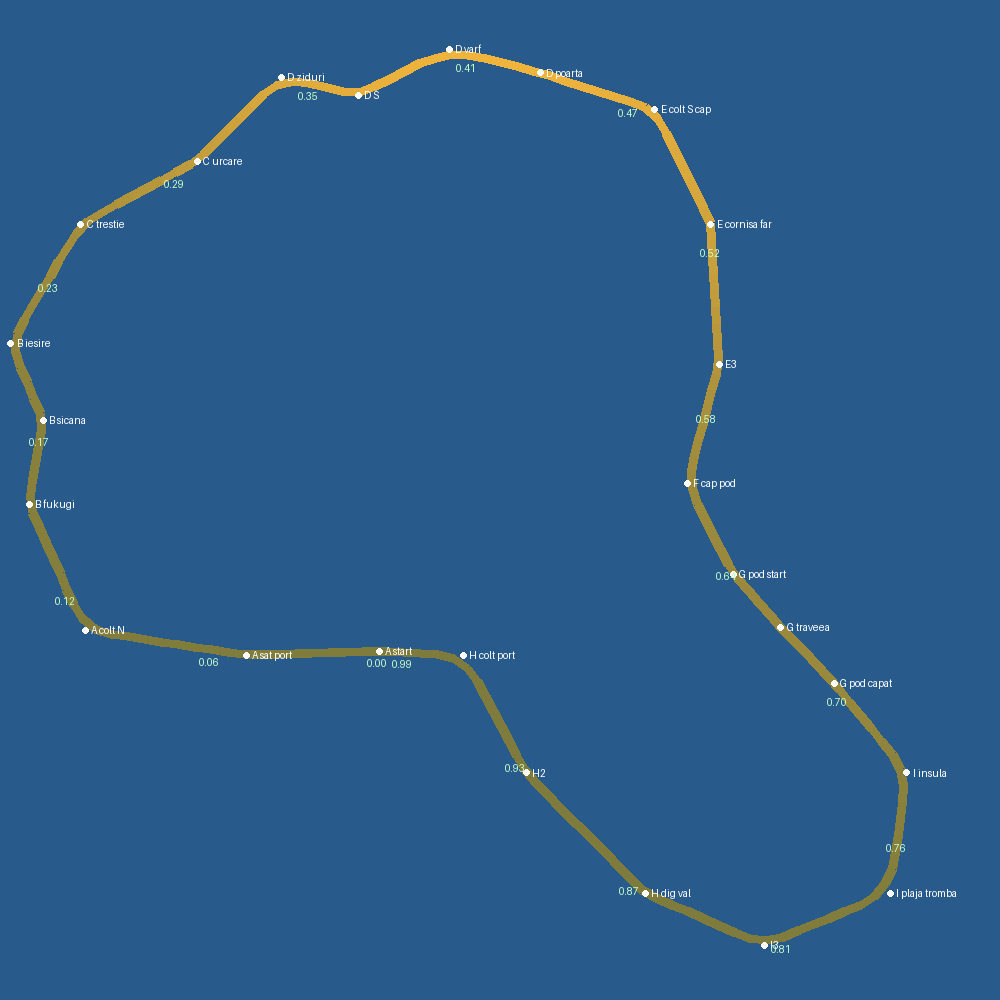

# Track brief — Okinawa (`Track20`, temă `okinawa`) — v0.1 (concept)

> Concept de pistă, înaintea listei definitive de assets. Scheletul e cel din
> `monument_valley.md`. Secțiunile de assets (§5) sunt un **audit al kitului
> existent** plus o schiță a pieselor noi. Lista completă se scrie după ce
> traseul trece de ProbeLayout, de ProbeRace și de captura `--gamecam`.
>
> **A doua pistă care înlocuiește una existentă**, după Monument Valley
> (Dunele → Track19). Okinawa ia locul lui `Track08` („Okinawa manual”) pe
> **indexul 1**, prin același mecanism în doi pași (§7).
>
> **v0.1 (7 oct 2026), cererea dezvoltatorului:** „la fel cum am refăcut
> Dunele în Monument Valley, refacem și Okinawa, inclusiv traseul”. Ce se
> păstrează: **podul care se ridică, cu vapoarele care trec pe dedesubt**, și
> **tromba**. Ce se adaugă: **valul**, care există în cod (`WaveSurge`) dar nu
> mai e pus pe pistă din august (`track08.gd:343`, `_wave_fracs()` întoarce
> `[]`). Locul nu e o singură zonă din Okinawa: **„luăm ce e mai frumos din
> toate”**. Pista e o insulă-dioramă compusă, ca orice pistă de jucărie, iar
> **fiecare reper de pe ea există undeva în Okinawa** (§1).
>
> **Ce e greșit la Track08 azi** (motivul refacerii, nu un gust):
> - e o insulă **generică**, cum erau și Dunele: laguna-gogoașă și traseul
>   vin dintr-un poster ChatGPT (`assets/okinawa_v2/okinawa_v2.png`), nu dintr-un
>   loc;
> - elementele de recunoaștere sunt **împrumutate din alte locuri**: palmierul
>   de cocos (Okinawa e subtropicală, cocotierul e rar), poarta **torii**
>   (Shinto din Japonia continentală; poarta Ryukyu e altceva), farul
>   roșu-alb de 9 m și corabia cu pânze europeană de sub pod (`tall_ship.glb`);
> - scara e mică față de cameră: zidul gusuku are **2,8–4,5 m**, farul
>   **9,1 m**, iar poarta **4,4 m**. Sub o cameră la 10 m înălțime, toate citesc
>   ca bordură;
> - hazardele sunt puse pe unde a rămas loc (scanarea `probe_typhoon --scan`
>   găsea „trei ferestre libere în tot turul”), nu legate de o poveste.
>
> **Ce e diferit față de celelalte piste cu apă.** Stromboli înseamnă *vulcan
> negru, sat alb, apus*. Fiordland înseamnă *pereți de gheață, ploaie, verde
> închis*. Baikal e *gheață și iarnă*. Chongqing e *oraș pe verticală, noapte*.
> Okinawa înseamnă **apă smarald pe nisip alb, olane roșii, ziduri de calcar
> care șerpuiesc pe deal, pod lung la nivelul mării și cer de taifun la
> orizont**. Diferența se verifică pe capturi puse alături (§6), nu se
> presupune.

## 0. Într-o propoziție

O după-amiază de octombrie în Okinawa, **în ziua dinaintea taifunului**:
soare cald din vest, mare smarald, iar la sud-est un perete de nori de
furtună. Pornești din **portul cu bărci de pescari** și treci printre casele
cu olane roșii și lei-shisa pe acoperiș. Intri în **tunelul de copaci fukugi**
pe o alee de nisip coraligen alb și urci printre **trestiile de zahăr** spre
deal. Șerpuiești pe lângă **zidurile curbe ale castelului** și treci **pe sub
poarta roșie de pe culme**. Ieși pe **cornișa capului de calcar**, cu farul
alb în față, și de acolo **vezi podul lung de jos și vaporul care se apropie
de el**. Cobori, **treci pe pod chiar când se ridică traveea** (sau nu) și
ajungi pe **insula mică**, pe drumul de plajă unde **o trombă de apă iese din
mare și traversează drumul**. Te întorci pe **digul cu tetrapozi**, unde
**valurile hulei trec peste șosea**, și intri înapoi în port.
Singura pistă din joc pe care **marea însăși e adversarul**: o vezi venind,
fie că e vapor, trombă sau val.

## 0.1 Regula de artă (ce NU e pista asta)

**Nu „insulă tropicală” generică** (cocotieri peste tot, colibe de stuf,
hula, tiki). **Nu Japonia continentală** (torii roșii Shinto, pagode,
cireși ca accent principal, Fuji). Okinawa e **Ryukyu**: alt regat, altă
arhitectură, altă vegetație. Ce trebuie să recunoască jucătorul în 3 secunde:
*„apă turcoaz peste nisip alb, case joase cu acoperiș de olane roșii și un
leu de piatră pe creastă, ziduri de piatră curbe pe deal, un pod lung la
nivelul mării.”* Olanele roșii cu mortar alb sunt pentru Okinawa ce sunt
Mittens-urile pentru Monument Valley.

Ce scoatem din Track08, cu motiv:
- **cocotierul ca arbore dominant**: Okinawa e subtropicală. Copacii-semnătură
  sunt **fukugi** (frunziș dens, închis, în șiruri de vânt), **gajumaru**
  (banianul, cu rădăcini aeriene), **pinul Ryukyu**, **pandanus** (adan) pe
  plajă, **cicade** (sotetsu) și **palmierul-evantai**. Rămân câțiva palmieri
  plantați lângă port, ca în orașele reale;
- **torii-ul de piatră**: poarta pistei devine o **poartă Ryukyu** (stâlpi
  roșii, acoperiș cu două trepte de olane), tiparul porții Shureimon;
- **farul roșu-alb**: farurile de pe capurile Okinawei sunt **albe** (Zanpa e
  un turn alb de 31 m pe o faleză de calcar);
- **corabia cu pânze** de sub pod: în locul ei vin un **feribot de insule**
  și un **vas de coastă cu catarg-radar**, adică vasele care trec cu adevărat
  pe sub poduri în Okinawa;
- **laguna-gogoașă** (interiorul buclei e apă): rămâne apa pe ambele părți,
  dar **doar pe pod și pe dig**. Interiorul insulei mari e uscat, cu deal,
  sat și castel, ca să existe ce vedea.

| pondere | strat |
|---|---|
| **35%** | apa și țărmul: smarald peste nisip (puțin adânc), albastru închis în larg, **nisip coraligen alb**, **stânci de calcar „ciupercă”** roase la bază de valuri (notch), tetrapozi, spumă |
| **25%** | satul și castelul: **case Ryukyu** (olane roșii cu mortar alb, shisa pe creastă, zid de corali în jur, paravan *hinpun* în fața ușii), **case de beton** cu acoperiș plat și **rezervor de apă cilindric** pe acoperiș (detaliul cel mai real al Okinawei moderne), **zidurile curbe ale castelului** de calcar, **poarta și palatul roșu** pe culme |
| **20%** | vegetația: **fukugi** în șiruri dese (tunelul), banian, pin Ryukyu, pandanus, cicade, **hibiscus roșu** și **bougainvillea magenta** (accentele vii), **trestie de zahăr** pe deal |
| **10%** | cerul și vremea: albastru sus, cumulus mari, **peretele de furtună la sud-est** (gri-ardezie, cu soarele bătând pe el), hula care sparge pe dig, tromba |
| **10%** | urmele omului, mărunte și reale: bărci de pescari *sabani*, plase și flotoare, automate de băuturi (fără mărci), stație de autobuz, oglinzi convexe la curbe, garduri de corali, rufe pe acoperiș |

Trei acte pe un tur, **aceeași paletă, altă proporție**:
- **insula mare** (sat, fukugi, trestie, castel: verde și roșu, umbră pătată);
- **capul și podul** (calcar, cer, apă adâncă: deschis, vânt, vapoare);
- **insula mică și digul** (nisip alb, turcoaz, spumă: furtuna vine).

Nu trei palete.

## 1. Referința reală (ce luăm din fiecare loc)

Okinawa-dioramă: **fiecare reper există**, doar că nu stau toate pe aceeași
insulă de 600 m. Compresia e declarată, ca la Monument Valley (arcul) și la
Kyoto (tunelul de torii).

| loc real | ce luăm |
|---|---|
| **Portul Motobu / Itoman**, porturile de pescari cu bărci *sabani* și case joase | **POI A**: startul în colțul golfului, cu bazinul portului, cheiul de beton, bărcile, plasele și flotoarele |
| **Satul Bise și aleea de fukugi** (Motobu): ~20 000 de copaci fukugi plantați ca paravan de vânt, peste alei de nisip coraligen | **POI B, tunelul de fukugi**: alee îngustă de nisip alb, între ziduri joase de corali, sub coroane care se închid deasupra. Contralumină pătată |
| **Satul Taketomi** (Yaeyama): case cu olane roșii, shisa pe acoperiș, ziduri de corali, nisip alb pe străzi | arhitectura satului din A și B: **casa Ryukyu** e piesa-erou a pistei |
| **Câmpurile de trestie de zahăr** din toată insula | **POI C**, urcarea spre deal. Trestia înaltă de 3 m face un culoar verde-gălbui |
| **Castelul Nakijin** (gusuku, UNESCO): ziduri de calcar de 6–10 m care șerpuiesc pe creastă în curbe largi | **POI D**: drumul urcă **pe lângă zidurile curbe**, iar ele sunt peretele care se simte (la < 40 m, memoria `munte-flanc-nu-fundal`) |
| **Castelul Shuri** (Naha): palatul roșu (*Seiden*) și poarta **Shureimon** (stâlpi roșii, acoperiș cu două trepte) | **POI D, culmea**: poarta roșie e **peste drum**, iar palatul stă pe platforma de alături. **Libertate declarată:** Shuri e în Naha, departe de Nakijin. Le unim fiindcă împreună dau silueta Okinawei: zidul curb plus roșul de pe culme |
| **Capul Manzamo** și **Capul Zanpa**: platouri de iarbă pe faleze de calcar, iar Zanpa are un far alb de 31 m | **POI E, cornișa**: drum pe buza falezei, cu marea dedesubt la stânga și farul alb pe vârful capului |
| **Podul Kouri** (~2 km, la câțiva metri peste o mare smarald) și insula Kouri, cu plaja Tinu și stânca în formă de inimă | **POI F, podul**: lung, jos, cu apă turcoaz pe ambele părți. **Libertate declarată:** podul Kouri nu se ridică. Traveea ridicătoare e mecanica pistei, ca arcul de la Monument Valley. **POI G, insula mică**: plaja, stânca-inimă în apă (numele **nu** apare, e dintr-o reclamă) |
| **Digurile cu tetrapozi** de pe coasta de est și de sud, unde hula de taifun sparge peste drum | **POI H, digul**: șoseaua joasă dintre larg și golf, cu tetrapozi pe partea dinspre larg și **valul** (§3) |
| **Insula Ie** (Iejima), cu muntele-con Gusukuyama, văzută de pe Motobu | **fundal** (`horizon_model`): silueta de con pe inelul de nord-vest. Se recunoaște de oriunde din nordul Okinawei |
| **Sezonul taifunurilor** (iulie–octombrie) și **trombele marine** (*tatsumaki*), care apar la marginea sistemelor de furtună | **hazardele de vreme**: tromba pe insula mică, hula pe dig, cerul de furtună la sud-est |

**Culorile locului** (de măsurat pe fotografii la construcția temei, nu
copiate):
- apa: turcoaz-smarald peste nisip (`#3FC1C0`), mai verde lângă mal
  (`#7FD6C2`), albastru adânc în larg (`#1F5E8E`);
- nisip coraligen alb-crem (`#EDE6D2`), mai cald la umbră (`#CDBFA0`);
- olane roșii-cărămizii (`#B8452E`), mortar alb (`#EEEAE0`);
- calcar Ryukyu gri-crem, poros (`#CFC6B0`), închis în nișe (`#8F8670`);
- roșul lăcuit al porții și al palatului (`#B3261E`), cu galben-auriu pe
  ornamente (`#D6A23A`);
- fukugi verde închis lucios (`#2E5A2C`), trestie verde-gălbui (`#9CB34E`);
- hibiscus roșu (`#D7263D`), bougainvillea magenta (`#C2378F`);
- cerul albastru sus (`#4A90D9`), peretele de furtună gri-ardezie
  (`#5E6878`) la sud-est.

**Lumina:** soare de după-amiază târzie, din VSV (~25°), cald. Peretele de
furtună de la SE e **luminat din față** de soare, deci tromba și norii se văd
aprinși pe un fundal închis. Contrastul acesta e identitatea cerului.

## 2.0 Verificarea cu camera (de ce reperele stau unde stau)

`ChaseCamera`: **10 m sus, 12,5 m în spate, 28,7° în jos, FOV 68°** (memoria
`verifica-cu-parametrii-lui`). Marginea de sus a cadrului e la **+5,25°**,
deci la distanța `d` camera vede cel mult **10 + 0,092·d** m peste cota
drumului. Jumătatea de cadru lateral e **~50°**. Fiecare reper e verificat pe
**patru axe**: distanță, verticală, **azimut** și **ocluzie** (memoria
`reperul-se-vede-pe-patru-axe`).

Tabelul de mai jos e măsurat pe schiță (`gen` de probă, §2.1), **fără
ocluzie**. Ocluzia (dealul, zidurile, fukugi) se măsoară pe `Track20` cu
`tools/okinawa_frustum_table.py`, înainte de decor:

| reper | de unde | poziția (hartă) | vârful peste mare | în cadru (≤ 50°) | întreg și sub ceață |
|---|---|---|---|---|---|
| palatul roșu + poarta | urcarea C (0,25 → 0,40) | (110, 285) | +46 m (culmea +30, palatul 16 m) | **26/26** | **22/26** (ultimii 55 m îl taie, corect: intri sub el) |
| farul alb | culmea D → capul E (0,42 → 0,53) | (318, 170) | +42 m (capul +22, farul 20 m) | 12/19 | 12/19 (de la 0,49 rămâne în stânga: treci pe lângă el) |
| tromba | podul F (0,62 → 0,72) | (400, −338) | +21 m (plaja +3, pâlnia 18 m) | **18/18** | **18/18**, la 140–310 m |
| traveea și canalul | cornișa E (0,50 → 0,62) | (322, −148) | catargul ~+10 m | **21/21** | **21/21**, privit **de sus** (drumul e la +22 → +9) |
| valul pe dig | insula G (0,78 → 0,86) | (225, −338) | +3 m | **14/14** | **14/14** |

Consecințele, scrise ca intenție:
- **Castelul e dezvăluirea.** Urcarea C merge spre NE, cu palatul la
  ≤ 25° de ax de la 330 m. Ceața trebuie să-l lase **întreg de la ~280 m**:
  `fog_end` ≥ 340.
- **Cornișa E e turnul de control.** De la +22 m vezi **în jos** podul, canalul
  și vaporul care vine. E singurul loc de unde îți poți planifica podul:
  telegraful lui e **vizual și de sus**, nu doar luminile de pe travee.
- **Tromba se vede de pe pod.** Pe tot podul ea e **drept în față**, la
  140–310 m, pe fundalul peretelui de furtună. Decizia (forțezi sau ridici
  piciorul) se ia înainte să cobori de pe pod.
- **Valul se vede de pe insulă.** Digul e în dreapta-față când cobori spre
  el, deci spuma care trece peste șosea se vede cu ~5 s înainte.
- **Farul nu e pe ax**, și nu trebuie să fie: e reperul pe lângă care treci
  pe cornișă (memoria `perete-paralel-nu-se-vede` lucrează aici în favoarea
  noastră: îl ai în față pe culme și apoi în stânga pe cornișă).
- **Fundalul:** insula Ie (conul) și insulele Kerama pe inel, la
  **200–340 m**, sub `fog_end`, sub `FAR_PLANE` (380), cu **`cast_shadow` OFF**
  (memoriile `efecte-de-fundal-cote-legate`, `caster-departat-fura-umbra`).

## 2. Traseul și punctele de interes (POI)

Lungime **~2 060 m** (tur ~65–70 s, 3 tururi ≈ 3:20), în fereastra Ignition
65–80 s din `ref_notes/sisteme.md`. Track08 are 1 806 m.

**Sens orar pe plan.** Insula mare ocupă vestul și nordul, insula mică e la
sud-est. Bucla trece **pe pod** din insula mare pe insula mică și se întoarce
**pe dig**. Între pod și dig rămâne **golful**, în interiorul buclei. Golful
e legat de larg prin canalul de sub pod, deci vapoarele intră pe sub pod spre
port. Asta e povestea traveei: **nu e un pod oarecare care se ridică, e
singura intrare în port**.

- A spre V, pe latura de sud a insulei mari (portul, satul);
- B spre N, pe latura de vest (fukugi);
- C spre NE, urcarea (trestia);
- D spre E, pe culme (zidurile, poarta);
- E spre S, pe latura de est (capul, farul);
- F spre SE (coborârea, podul);
- G spre S, apoi spre V, pe insula mică (plaja, tromba);
- H spre NV, pe dig, înapoi în port.

| POI | fracții | cote | lățime (semi) | ce e |
|---|---|---|---|---|
| **A** portul | 0,97 → 0,10 | +2 | 7 | startul, bazinul portului în colțul golfului, cheiul, satul cu olane, palmieri plantați |
| **B** aleea de fukugi | 0,10 → 0,22 | +2,5 → +6,5 | **5,5** | alee de **nisip coraligen** (`custom_dirt_ranges`, nuanță albă), cu o șicană, ziduri de corali, tunel de coroane |
| **C** trestia | 0,22 → 0,33 | +6,5 → +25 | 7 | urcarea spre NE, castelul în parbriz, case de beton cu rezervoare pe acoperiș |
| **D** castelul | 0,33 → 0,46 | +25 → +30 | 6 | S-uri pe lângă zidurile curbe, **poarta roșie peste drum la ~0,43**, palatul pe platforma din stânga |
| **E** capul | 0,46 → 0,58 | +27 → +14 | 7 | cornișă pe faleza de calcar, **marea la stânga, fără parapet**, farul alb pe vârful capului |
| **F** podul | 0,58 → 0,70 | +14 → +8,5 | 6,5 pe pod | coborârea, apoi **podul lung** (0,645 → 0,698) cu **traveea ridicătoare la ~0,669** |
| **G** insula mică | 0,70 → 0,83 | +8 → +2 | 7 | drumul de plajă, pandanus, stânca-inimă în apă, **tromba la ~0,77** |
| **H** digul | 0,83 → 0,97 | +1,6 | 6,5 | dig jos, tetrapozi spre larg, golful spre interior, **valul la ~0,87** |

**Schița măsurată** (7 oct 2026, generator de probă pe tiparul
`gen_monument_route.py`: fillet-uri pe arc, pas 12 m):
- **2 064 m**, sens orar;
- rază minimă **29,3 m** (intrarea în zidurile D);
- pantă maximă **8,0%** (coborârea de pe cornișa E);
- separare minimă **124 m** (pod ↔ dig, peste golf);
- centroid la (106, −51), Cebîșev **330 m** (zidul lumii e la 420; memoria
  `ziduri-invizibile-ale-lumii`).

| porțiune | cote | lungime | pantă |
|---|---|---|---|
| urcarea C | +6,5 → +25 | ~260 m | ~7% |
| culmea D | +25 → +30 | ~270 m | ~2% |
| cornișa și coborârea E–F | +27 → +9 | ~290 m | **8%** max |
| podul | +8,5 | ~110 m | 0 |
| insula G | +8 → +2 | ~270 m | ~2% |
| digul H | +1,6 | ~200 m | 0 |

**De măsurat cu ProbeLayout:** pantă < 13%, rază ≥ 9 m, apropiere de sine
≥ 20 m. Bucla stă la < 420 m de centroid, iar nimic nu iese sub plasa de mare.

```
   N ↑                         [D] culmea: ziduri curbe, POARTA roșie (+30)
                    ┌──────────────────────────────►┐
                    │ [C] trestia (urcare spre NE)    │ [E] capul: cornișă, FARUL alb
   [B] fukugi       │  palatul roșu în parbriz        │     marea jos la stânga
   alee de nisip    │                                 ▼     (vezi podul și vaporul)
   alb, șicană  ▲   │        INSULA MARE              │
                │   │   (deal, sat, castel)           │ [F] coborârea
                │   ┘                                 └──┐
   [A] START ◄──┴──── satul cu olane ◄── portul ◄┐       │ PODUL (traveea 0,669)
       spre V                                   │ GOLFUL  ╲   ⇅ canal, VAPOARE
                                           [H] DIGUL      ╲
                                           tetrapozi,      [G] INSULA MICĂ
                                           VALUL (0,87)     plaja, stânca-inimă
                                                  ◄──────── TROMBA (0,77)
                                 LARGUL (sud), hula vine de aici
```

### 2.1 Schița de waypoint-uri (sursa generatorului)



Coordonate de hartă: x est, y nord, metri. În Godot: `gx = x`, `gz = −y`
(convenția din `gen_kyoto_route.py`, **fără oglindire**). Coloanele sunt:
(x, y, rază de fillet, cotă, etichetă).

```python
WPTS = [
    (35, -165, 0, 2.0, "A start"),        (-60, -168, 0, 2.0, "A sat port"),
    (-175, -150, 34, 2.5, "A colt N"),    (-215, -60, 0, 4.0, "B fukugi"),
    (-205, 0, 22, 5.0, "B sicana"),       (-228, 55, 26, 6.5, "B iesire"),
    (-178, 140, 38, 12.0, "C trestie"),   (-95, 185, 0, 19.0, "C urcare"),
    (-35, 245, 30, 25.0, "D ziduri"),     (20, 232, 26, 28.0, "D S"),
    (85, 265, 55, 30.0, "D varf"),        (150, 248, 0, 30.0, "D poarta"),
    (232, 222, 36, 27.0, "E colt S cap"), (272, 140, 0, 22.0, "E cornisa far"),
    (278, 40, 0, 14.0, "E3"),             (255, -45, 34, 9.0, "F cap pod"),
    (288, -110, 0, 8.5, "F pod start"),   (322, -148, 0, 8.5, "F traveea"),
    (360, -188, 0, 8.5, "F pod capat"),   (412, -252, 34, 5.0, "G insula"),
    (400, -338, 40, 3.0, "G plaja tromba"), (310, -375, 34, 2.0, "G3"),
    (225, -338, 0, 1.6, "H dig val"),     (140, -252, 40, 1.6, "H2"),
    (95, -168, 36, 1.8, "H colt port"),
]
```

Repere fixe pentru garda de azimut (nu se derivă din traseu; memoria
`garda-circulara-propria-functie`): palatul (110, 285), farul (318, 170),
centrul traveei (322, −148), tromba (400, −338), digul (225, −338).

**Marea și golful.** Cota mării absolută e **0**. Cota drumului pe dig e
**+1,6** (freeboard-ul tetrapozilor din Track08, păstrat), iar podul e la
**+8,5** (degajarea traveei pentru catarg, `lift_bridge_hazard.gd:59`).
- **Larg** în afara buclei, prin tema `okinawa` (marea de insulă, ca
  `island`), cu `custom_sea_level_offset` derivat din cota medie a drumului;
- **golful** în interiorul buclei, ca `custom_lagoon` (poligonul dintre pod,
  insula mică, dig și coasta insulei mari), puțin adânc, deci **turcoaz**;
- **canalul de sub pod**, ca `TrackChannel` cu `jump = false` (podul
  ridicător), cu `reach` cât să lege largul de golf. Tiparul e Strâmtoarea
  Kaiun din Track08 (`track08.gd:749`).

## 3. Hazarduri și mecanici

Acoperirea celor cinci clase din `ref_notes/sisteme.md` §3:

| clasă (Ignition) | aici |
|---|---|
| **teatru** | vapoarele pe canal, bărcile din port, peretele de furtună la SE, hula care sparge pe tetrapozi în tot H, stârci albi, rufe care fâlfâie, rândunelele de mare, broasca țestoasă pe plajă (decor, nu pe drum) |
| frecare | **nisipul coraligen** din B (`loose_grip`), **șoseaua udă** pe dig după fiecare val (doar cât trece valul) |
| **oprire** | **podul** (dacă intri prea încet când e sus, cazi în canal; e mecanica moștenită, cu repunere) |
| sabotaj de control | **tromba** (te ridică 1,5 s: pierzi contactul, nu controlul), **valul** (împingere laterală + frână + grip tăiat) |
| **aruncare** | tromba, săritura de pe buzele podului când traveea e sus |

| mecanică | pe scurt | ce cere în cod |
|---|---|---|
| **Podul ridicător** (F, ~0,669) | traveea urcă vertical între doi piloni la interval fix, iar golul de 12 m se sare de la ~24 m/s (71% din viteza de vârf). **Vapoarele sunt ceasul**: le vezi intrând pe canal de pe cornișa E, cu ~15 s înainte. Ciclul rămâne cel din cod (`PERIOD` 10 s, `OPEN_HOLD` 3 s, `WARN` 2 s), apoi se reglează la volan | **reuse** — `TrackChannel` cu `jump = false` → `Track._build_lift_bridge` (`track.gd:12565`), ca în Track08 (`track08.gd:749`) și Track15. **Mic, nou:** modelul vaporului e constantă (`SHIP_PATH`, `lift_bridge_hazard.gd:94`, corabia cu pânze). Devine export (`ship_model`, `ship_node`), cu implicitul neschimbat, deci Track08 și Track15 rămân bit-identice. Okinawa primește **feribotul** și **vasul de coastă** (§5) |
| **Tromba** (G, ~0,77) | pâlnie de 18 m care iese din mare și traversează drumul de plajă dus-întors (11 s). Te ridică ~1,5 s și te lasă tot pe șosea, mai încolo (`_steer_lofted`). Vizibilă **de pe tot podul**, drept în față | **reuse** — `TyphoonHazard`, prin `HazardMarker kind = TYPHOON` (ca nodul din Track08.tscn). Fracția finală iese din `tools/probe_typhoon.gd --scan --track=20`, nu din ochi. **De verificat:** pâlnia trebuie să pornească **din apă** (pe plajă, partea dinspre larg e la ~20 m). Altfel apare din nisip |
| **Valul** (H, ~0,87) | hula sparge peste dig și **trece peste șosea pe toată lățimea**, la 9 s, cu spuma vizibilă cu 1,6 s înainte. Te împinge lateral, te frânează și taie grip-ul cât e apa pe asfalt. Digul devine o **decizie**: intri acum sau ridici piciorul o secundă | **reuse** — `WaveSurge` (`wave_surge.gd`), prin `HazardMarker kind = WAVE` sau `custom_wave_fracs`. **Cere o temă cu mare** (`water`), deci tema `okinawa` o are. **„Implementat” înseamnă:** pus pe Track20, verificat cu `tools/ProbeWave.tscn` pe pista nouă (azi sonda e legată de Track08), plus captură `--gamecam` cu valul pe drum. **De verificat:** valul vine **dinspre larg** (sud-vest), nu dinspre golf |
| **Aleea de nisip** (B) | suprafață de nisip coraligen alb, grip mai mic, praf alb în urmă | **reuse** — `custom_dirt_ranges` (Monument Valley), cu `dirt_road_tint` alb-crem în tema `okinawa` |
| **Cornișa** (E) | drum pe buza falezei, fără parapet spre mare | **reuse** — `custom_cornice_ravines` + `custom_ravine_water` (marea la picior) + plasă de repunere |

**Ce NU e nou:** podul, tromba, valul, aleea de nisip, cornișa. **Un singur
lucru nou în cod**, și e mic: modelul vaporului ca export. Identitatea vine
din **loc + apă + cele trei hazarde legate de mare**, nu din numărul de
mecanici.

**Distanțe între hazardele cu ceas** (lecția din `track08.gd:267`: „două
hazarde cu ceas lipite nu produc două decizii, produc o loterie”): pod
0,669 → trombă 0,77 = **~210 m**; trombă → val 0,87 = **~205 m**; val → pod
(peste start) = **~1 650 m**. Toate trei sunt în a doua jumătate a turului,
**deliberat**: prima jumătate (sat, fukugi, trestie, castel) e respiro-ul și
condusul pur, iar a doua e „marea”.

### 3.1 Decizii pentru dezvoltator

1. **Numele de afișare.** „Okinawa” e nume de loc, fără marcă. **Recomandare:
   „Okinawa”** (fără „manual”). Recordurile sunt pe cheie `TRACK_NAMES`
   (`game_state.gd:61`), deci recordurile lui „Okinawa manual” rămân orfane la
   swap. E corect, fiindcă e altă pistă.
2. **Scurtătura.** Track08 avea pragul de corali. **Propunere: „bancul de
   nisip”**, o limbă de nisip care apare la reflux în golf (ca la Hatenohama),
   de la capătul podului (~0,70) direct spre începutul digului (~0,82). Taie
   drumul de plajă, deci **ocolește tromba**, dar e nisip ud (0,8×) și trece
   **prin culoarul ei de rătăcire**. Pe scurt, nu e o scăpare gratuită. Se
   măsoară cu ținta de la Monument Valley (−25…35% lungime, +0,5…1,5 s).
   **Recomandare: da**, după ProbeRace pe bucla fără ea.
3. **Broasca țestoasă** (azi `SlidingHazard` pe drum în Track08). Cererea a
   numit trei hazarde. **Recomandare:** rămâne **decor pe plajă** (animată,
   are deja `Walk`/`Idle`), nu pe drum.
4. **Hula pe tot digul ca teatru.** În afară de valul-hazard, spuma sparge pe
   tetrapozi pe toată lungimea lui H (doar vizual, particule cu limită de
   count). **Recomandare: da.** Altfel valul pare un eveniment izolat pe o
   mare liniștită.
5. **Palatul de pe culme**: siluetă roșie compusă din Shuri (care a ars în 2019
   și se reconstruiește, cu finalizarea anunțată pentru toamna 2026).
   **Recomandare: palat întreg, restaurat**, fără numele lui în joc.

## 4. Paleta și lumina (fără slot nou)

**Nu există slot liber** (32 din 32, ultimul `FLAMINGO_PINK` 31). Okinawa se
face din **sloturi existente + clase noi pe dale existente** (memoriile
`slot-reutilizat-intre-piste`, `tenta-pe-clasa-partajata`: **fără** retentarea
claselor partajate, iar tenta doar întunecă, deci luminosul cere
`CLASS_LIFT`). Se măsoară **după remap**, în joc (memoria
`monocromia-se-masoara-dupa-remap`).

| rol | slot existent / clasă |
|---|---|
| apa: golf turcoaz, larg adânc | `REEF_SHALLOW` 17, `SEA_DEEP` 18 (sloturile insulei, deja calibrate pe Track08) |
| nisipul, aleea B, plaja G | `CORAL_SAND` 19 (alb-crem), `SAND_SHADOW` 2 la umbră |
| spuma, mortarul de pe olane, farul | `FOAM_WHITE` 22 |
| olanele | `TILE_TERRACOTTA` 23 |
| roșul lăcuit al porții și al palatului | `CAR_RED` 14 (de măsurat: dacă iese „plastic”, clasă `ok_lacquer` pe dala de lemn, fără să atingă clasa `wood`) |
| ornamentele aurii | `CAR_YELLOW` 16, în puncte mici |
| calcarul Ryukyu (ziduri, faleze, stânci-ciupercă) | `ROCK_LIGHT` 3 + clasă nouă **`ok_limestone`** pe o dală poroasă existentă (candidata e `coral_rock`, care e deja triplanar la scara 0,85; de comparat cu `mv_cap`) |
| crăpăturile, nișele (notch) | `ROCK_DARK` 4, **nu** pe calcar alb în suprafețe mari (memoria `rock-dark-nu-pe-bazalt`: iese rugină) |
| fukugi, banian, pin | `TROPICAL_GREEN` 21 (dominant), `CACTUS_GREEN` 12 (cicade, pandanus) |
| trestia | `DRY_VEGETATION` 13 + `TROPICAL_GREEN` 21 |
| hibiscus / bougainvillea | `KERB_RED` 7 / `FLAMINGO_PINK` 31 (accentele vii, puncte mici) |
| betonul (cheiul, digul, podul, casele moderne) | `CONCRETE` 8 |
| asfaltul | `ASPHALT` 5 + `ASPHALT_EDGE` 6, linie albă |
| tetrapozii | `CONCRETE` 8 (clasa `concrete`, ca în kit) |

**Lumina:**
- **soarele:** ~25° din VSV, `#FFD9A8`, energie ~1,0. `exposure` **se
  măsoară**;
- **ambientul:** cer albastru curat, ~`#A8C4E0` la 0,3. Umbrele de sub fukugi
  trebuie să rămână **verzi-albăstrui**, nu negre (memoria
  `umbra-fara-culoare-e-negru-mort`);
- **cerul:** `#4A90D9` sus, alb-cald la orizont spre vest, **gri-ardezie spre
  SE** (peretele de furtună). De verificat dacă `sky` permite asimetria pe
  azimut. Dacă nu, peretele de furtună devine `horizon_model` (o fâșie de nori
  ca siluetă, ca haboob-ul vizual, fără gameplay);
- **ceața:** 140 → 350 m, curbă 1,4, maximă ~0,6, alb-albăstruie (spray
  marin), măsurată HSV față de culoarea apei (memoria
  `ceata-in-familia-solului`, aici „în familia mării”);
- **umbrele:** pornite (`theme_shadows`), `shadow_distance` 90. Tunelul de
  fukugi e locul în care umbra pătată e identitatea, nu un cost.

**Azimutul soarelui față de drum** (se remăsoară la fiecare redesenare,
memoria `azimutul-soarelui-fata-de-drum`):

| porțiune | direcție | soarele | ce dă |
|---|---|---|---|
| A | spre V | din față, sus | contralumină pe sat: olanele cu muchia aprinsă, străzile în umbră |
| B | spre N | din stânga | lumină pătată prin fukugi, raze laterale |
| C–D | spre NE / E | din spate | **castelul și poarta luminate din față**: dezvăluirea arată bine |
| E–F | spre S / SE | din dreapta-spate | marea și podul luminate lateral, **peretele de furtună aprins** în față |
| G | spre S → V | din dreapta, apoi din față | tromba e întâi aprinsă pe nori închiși, apoi în contralumină |
| H | spre NV | din stânga-față | **spuma valului în contralumină**: strălucește |

## 5. Assets

Categoria nouă `assets/models/okinawa/`, cu subfolderele `buildings/`,
`structures/`, `rocks/`, `plants/`, `props/`, `vehicles/`, `effects/`
(memoria `assets-models-categorii`). Kitul vechi rămâne pe loc (Track08 îl
folosește până la swap). Piesele refăcute sunt **fișiere noi**, nu suprascrieri.

### 5.1 Auditul kitului existent (ce refolosim, ce refacem)

Cotele sunt cele din `docs/asset_briefs/okinawa_kit.md`. Ținta de scară vine
din cameră (memoria `inaltimea-obiectelor-si-camera`): un obiect de la
marginea drumului care trebuie **citit** cere ≥ 3–4 m, iar un reper care
trebuie **văzut de departe** cere ≥ 15 m.

| asset | azi | verdict | de ce |
|---|---|---|---|
| `structures/tetrapod.glb` | 1,8 / 3,5 m | **păstrat, scalat 1,4–1,8×** | iconic, e povestea valului. La 1,8 m citesc pietriș sub cameră. Tetrapozii reali de dig au 3–5 m |
| `rocks/coral_rock.glb` (8 variante) | 0,4–3,8 m | **păstrat ca scatter** + **refăcut ca piesă nouă** | lipsește **stânca-ciupercă de calcar** (roasă la bază, *notch*), semnătura coastei Okinawei: `ok_notch_rock` A/B/C, 4–9 m, plus **stânca-inimă** |
| `scatter/island_scatter.glb` | 0,1–0,5 m | **păstrat** | iarba de plajă, lemnul de apă și pietricelele sunt corecte |
| `structures/sea_wall_segment.glb` | 1,2–1,6 m | **păstrat** | parapetul digului H |
| `trees/coconut_palm.glb` | 6,7 m | **redus la câțiva, doar în port** | nu e arborele Okinawei (§0.1) |
| `trees/beach_palm_bent.glb` | 2,8 m | **scos** | silueta de „insulă tropicală” |
| `trees/pandanus.glb` | 2,4 m | **păstrat, scalat ~1,6×** | *adan*, corect pe plajă. La 2,4 m e tufă |
| `trees/banyan.glb` | 5,6 m | **păstrat, scalat ~1,6×** | *gajumaru*, corect. Un banian matur are 10–15 m și e reper de sat |
| `plants/hibiscus_bush.glb` | 0,9 m | **păstrat** | accent roșu. Se adaugă bougainvillea (`build_bougainvillea.py` există, Stromboli) |
| `plants/sugar_cane_clump.glb` | 2,8–3,6 m | **păstrat** | POI C |
| `structures/stone_gate_torii.glb` | 4,4 m | **înlocuit** | torii e Shinto continental. Vine **`ryukyu_gate`** (stâlpi roșii, acoperiș în două trepte, ~9 m, peste un drum de 12 m; lățimea se măsoară pe `custom_width_segments`, memoria `contract-de-kit-cere-latimea-drumului`) |
| `buildings/lighthouse.glb` | 9,1 m, roșu-alb | **refăcut** | **`cape_lighthouse`** alb, ~20 m, cu casa paznicului, pe faleză |
| `props/shisa_statue(_closed).glb` | 1,7–1,8 m | **păstrat**, scalat ~1,5× la poartă | perechea de la poartă trebuie văzută. Pe acoperișuri rămân mici (vin în modelul casei) |
| `structures/gusuku_wall.glb` | 2,8–4,5 m, drept | **refăcut** | zidurile Nakijin sunt **curbe** și de **6–10 m**: `gusuku_wall_curve` (module curbe de 2 raze), `gusuku_wall_straight`, `gusuku_arch_gate` (poarta boltită de piatră) |
| `vehicles/sabani_boat.glb` | 5 m | **păstrat** | portul și plaja |
| `scatter/beach_clutter.glb` | 0,2–1,4 m | **păstrat** | lăzi, flotoare, ulcioare |
| `effects/horizon_island.glb` | 6,6–26 m | **păstrat** + piesă nouă **`ie_island`** (conul Iejima) | conul se recunoaște de oriunde din nordul Okinawei |
| `effects/wave_surge.glb` | 3 m / 30 m | **păstrat**, de verificat pe dig | e piesa valului (refăcută în aug 2026, o singură bucată de 30 m). Pe un drum de 13 m acoperă tot |
| `props/sea_turtle.glb` (animat) | 3,6 m | **păstrat, decor pe plajă** | §3.1.3 |
| `buildings/village_house.glb` | — | **de evaluat pe captură**, probabil refăcut | casa Ryukyu e piesa-erou: olane roșii cu mortar alb **în relief** (nu culoare plată), shisa pe creastă, zid de corali, *hinpun*. Se compară cu fotografia înainte de decizie |
| `effects/typhoon.glb` | 18 m | **păstrat**, de revăzut vizual | pâlnia trebuie să citească **trombă marină** (spray la bază, pe apă), nu tornadă de câmpie |
| `vehicles/tall_ship.glb` (vaporul podului) | — | **înlocuit pe Okinawa** | corabie europeană. Vin **`island_ferry`** și **`coastal_freighter`** cu catarg-radar (§3) |
| `structures/fence_ranch.glb` (azi în Track08) | — | **scos** | gard de fermă americană. Vine **zidul de corali** (`coral_stone_wall`) |

### 5.2 Piese noi (schiță)

**Hero:** `ryukyu_palace` (palatul roșu, ~16 m, pe platformă de piatră),
`ryukyu_gate`, `gusuku_wall_curve` / `_straight` / `gusuku_arch_gate`,
`cape_lighthouse`, `ryukyu_house` A/B/C (olane, shisa, zid de corali,
hinpun), `concrete_house` A/B (acoperiș plat, **rezervor de apă cilindric**,
rufe), `harbour_quay` (chei, scări, babale), `island_ferry`,
`coastal_freighter`, `heart_rock`.
**Kit:** `fukugi_tree` (3 variante, frunziș dens în coloană, **piesa care
face tunelul B**), `ryukyu_pine`, `fan_palm`, `cycad`, `bougainvillea`,
`coral_stone_wall` (modul jos, poros, cu pietre rotunjite), `ok_notch_rock`
A/B/C, `limestone_cliff_module` (faleza E și capul), `vending_machine`
(fără text, fără marcă), `bus_stop_shelter`, `convex_mirror`,
`fishing_net_rack`, `water_buffalo` (decor în sat, opțional).
**Fundal:** `ie_island`, `kerama_islands`, `storm_wall` (fâșia de nori de
furtună, dacă cerul nu o poate da; §4).

### 5.3 Trecerea de contracte — **de făcut înainte de primul build**

Memoria `brief-cere-glb-cod-il-face-deja`: înainte de comanda de kit se
verifică ce face deja codul.
- **Pilonii și traveea podului** sunt construiți de `LiftBridgeHazard`
  (`bridge_ramp.glb` + turnuri). **Nu** se comandă un pod ca GLB;
- **valul** e `wave_surge.glb`, deja refăcut;
- **pâlnia** e `typhoon.glb`, deja derivată din cameră (18 m);
- **marea, golful și canalul** sunt teren + apă din cod;
- **casele de pe acoperiș cu shisa**: shisa e în modelul casei, nu e o piesă
  separată plasată de mână.

## 6. Bugete

| buget | țintă | cum se măsoară |
|---|---|---|
| materiale | **≤ 30** (garda pică la 38) | `probe_decor --track=20` |
| triunghiuri | raportate, fără plafon (CLAUDE.md) | `probe_decor` |
| timp de încărcare | ≤ Track19 + 0,5 s, **cu fereastră** | `probe_load_time` (memoria `headless-ascunde-citirea-de-pe-gpu`) |
| vegetația în masă | fukugi + trestie + palmieri pe **MultiMesh** peste ~1 000 de piese | memoria `decor-in-masa-cere-multimesh` |
| particule | hula de pe dig cu limită de count, spray-ul trombei din `typhoon.glb` | `probe_fx` |
| ProbeRace | 8 mașini, 16 seed-uri: **0 ieșiri din lume**, repunerile doar la pod (intenționate), `[blocaj]` = 0 în B (aleea îngustă) | memoria `zero-repuneri-ascunde-blocajul` |

## 7. Ordinea de construcție

1. **Brief v0.1** (acest document). PR propriu.
2. **Fundația `Track20.tscn`** din `tools/gen_okinawa_route.py` (copie de
   `gen_monument_route.py`):
   - garda de azimut scrisă **înaintea** traseului, pe reperele fixe din §2.1
     (castel din C, farul din D–E, tromba de pe pod, canalul de pe cornișă,
     digul de pe insulă); plus `--sabotaj`, care trebuie să pice;
   - tema **`okinawa`** în `Track.themes()` (pornind de la `island`, nu
     editând-o), cheia în enum-ul `track_from_path.gd:26-27`,
     `info/Track20.tres` (regiune „JAPONIA”, accent turcoaz `(0.16, 0.62,
     0.66)`, cel de la Track08);
   - `custom_name` și `custom_world_seed_name` **înghețate** de la prima
     generare;
   - pe traseu: `custom_lagoon` (golful), `TrackChannel` cu `jump = false`
     (podul + canalul), `custom_dirt_ranges` (B), `custom_width_segments`,
     cornișa E (`custom_ravines` + `custom_cornice_ravines` +
     `custom_ravine_water`), `HazardMarker` TYPHOON și WAVE. Tetrapozi și
     ziduri **provizorii** din kitul vechi în `DecorManual`, ca să se vadă
     scara;
   - **export `ship_model`** pe `LiftBridgeHazard`, implicitul neschimbat
     (Track08 + Track15 bit-identice);
   - `GameState`: Track20 **la coada listei** (indexul 13). Okinawa manual
     rămâne pe indexul 1 până la swap. Toate uneltele o adresează cu
     `--track=20` (`resolve_track_index`).
3. **Gărzi:** `ProbeLayout --track=20`, `ProbeBuried`, `ProbeLaneClear` (linie
   de bază „… (Track20)” fără marjă + `--sabotaj` care pică), `ProbeCameraSolid`
   (poarta, zidurile, tunelul de fukugi), `probe_typhoon --scan --track=20`
   (fracția trombei), `ProbeWave` pe Track20, `probe_bridge` pe canal.
4. **ProbeRace la început**: 8 mașini, 16 seed-uri. Se citesc `[blocaj]` /
   lent / invers / carusel, nu doar repunerile.
5. **Tabelul de frustum cu ocluzie** (`tools/okinawa_frustum_table.py`):
   garda trebuie să pice pe o stare stricată.
6. **Verdictul dezvoltatorului la volan** pe fundație: se simte dezvăluirea
   castelului? Cornișa ca turn de control pentru pod? Tromba văzută de pe pod?
   Valul ca decizie, nu ca taxă?
7. **Planul real adnotat** (`Snapshot.tscn -- --track=20 --no-fog`, **cu
   fereastră**, apoi `tools/annotate_okinawa_plan.py`, tiparul
   `annotate_monument_plan.py`) → **prompturile ChatGPT v0.2 (§9)** →
   dioramă + planșă de inventar → kit Blender
   (`docs/asset_briefs/okinawa_kit_v2.md`, `tools/blender/verify_okinawa.sh`)
   → integrare → POI A–H (gauntlet, valuri de 3).
8. **Commit-ul de swap**, după decor și după al doilea verdict la volan:
   - Track20 pe indexul 1, Track08 scos din `TRACK_SCENES` / `TRACK_NAMES`;
   - **Track08 rămâne în repo**, ca banc de test. Sondele care îl încarcă:
     `probe_wave`, `probe_typhoon`, `probe_camera_solid`, `probe_decor`,
     `probe_lane_clear`, `probe_manual`, `probe_path_seed`,
     `verify_all_tracks_load` trec **pe cale** sau pe `--track=20`;
   - gărzile cu cheia „Okinawa manual (Track08)” se mută.

## 8. Lecții aplicate anticipat, și ce a fost respins

- **Patru axe, scrise înaintea traseului.** Castelul, cornișa-turn-de-control
  și tromba de pe pod sunt **derivate** din tabelul de frustum (§2.0).
- **Scara e decizie.** Zidurile de 6–10 m, farul de 20 m și palatul de 16 m
  sunt la scara de joc, nu reale (Zanpa are 31 m).
- **Fără oprire pe termen lung:** podul te aruncă în canal și te repune;
  tromba și valul împing, nu blochează.
- **Hazardele cu ceas la ≥ 200 m unul de altul** (§3).
- **Unealta de captură înainte de captură:** `Snapshot` are deja
  `--wave-at=` și `--typhoon-at=` (`snapshot.gd:518-521`). Pentru pod se
  verifică la fundație dacă există o fază forțată (traveea sus + vaporul
  sub ea); dacă nu, intră **odată cu fundația** (memoria
  `unealta-de-captura-e-parte-din-masuratoare`). Altfel prima captură „cu
  vaporul sub pod” e noroc.
- **Diorama din geometria reală** (memoria `diorama-din-geometria-reala`):
  prompturile se scriu pe captura reală a lui Track20, nu pe schița de aici.
- **Respectul e regulă de design.** Okinawa are locuri sacre și răni
  recente:
  - **niciun *utaki*** (crângurile sacre, ex. Sefa-utaki) și **niciun
    mormânt-broască-țestoasă** (*kamekobaka*), deși sunt peste tot în peisaj;
  - **nimic din bătălia din 1945** (memoriale, peșteri-adăpost) și **nimic
    militar** (baze, avioane, garduri cu sârmă ghimpată). E subiect politic
    viu în Okinawa;
  - **niciun om în costum** (dansatorii eisa, costumele de curte Ryukyu);
  - **fără ceremonii** la castel: e monument, nu decor de ritual.
- **Legal și nume:**
  - fără mărci: acvariul cunoscut, berea locală, lanțurile de fast-food și de
    înghețată, automatele cu logo. Automatele **fără text**;
  - „Heart Rock” nu apare (vine dintr-o reclamă), doar forma;
  - numele castelelor (Shuri, Nakijin) nu apar în UI;
  - semnele de drum **fără text lizibil**.
- **Respins, cu motiv:**
  - **cocotierii ca peisaj dominant**, **torii-ul**, **corabia cu pânze**
    (§0.1);
  - **laguna-gogoașă** (interiorul ca apă): ascundea insula. Apa pe ambele
    părți rămâne, concentrată pe pod și pe dig;
  - **broasca țestoasă pe drum**: rămâne pe plajă (§3.1.3);
  - **un al patrulea hazard** (bivolul de apă, autobuzul): cererea a fost trei.
    Bivolul poate fi decor;
  - **Kokusai-dori** (strada comercială din Naha): oraș dens, adică
    identitatea lui Chongqing;
  - **cireșii în floare** (ianuarie la Nakijin): pista e în octombrie.

## 9. Prompt pentru ChatGPT (dioramă de referință) — v0.2, paste-ready

**Se atașează doar `docs/track_briefs/img/okinawa_plan/okinawa_plan.png`**,
într-o **conversație nouă**. Planul e captura REALĂ de sus din Godot a
fundației (`Snapshot.tscn -- --track=20 --no-fog`, cu fereastră), cu legenda
desenată de `python tools/annotate_okinawa_plan.py` (scara corectată pe
pixelii de asfalt, `PLAN_FIT`). Pista e sursa de adevăr (memoria
`diorama-din-geometria-reala`).

Ce se ia din Monument Valley v0.2 de la început: **densitatea pe cifre**
(verdictul „săracă” de la volan), **„ONE CLOSED LOOP”** ca prim paragraf,
**hazardele surprinse în cadru** și lista **FORBIDDEN** din §8. Camera e din
**colțul de SV** al planului (stânga-jos): în prim-plan digul cu valul și
satul, la mijloc golful și podul cu vaporul, iar în fund insula mică și
tromba pe **peretele de furtună**. Soarele vine din stânga-spate, deci scena
e luminată din față și tromba se aprinde pe norii închiși.

> Create a stylized low-poly **tabletop diorama** of a toy-car racing track on
> a **subtropical island in Okinawa, Japan (Ryukyu Islands), on a late
> afternoon in October, the day before a typhoon**. **Use the attached
> top-down plan as the exact layout: same loop shape, same coastline, same
> bay, same position of every landmark.** The letters A–H, the circles, red
> arrows, dashed white arrow, text boxes and the legend strip under the plan
> are a legend: do not draw them. On the plan: the thin white line with the
> dark grey band is the **asphalt road**; the cream band on the left (B) is a
> **white coral-sand lane**; the violet band on the right (E) is a
> **cliff-top road** with the sea far below on its left; the dark band (F) is
> a **long low bridge**; the grey band at the bottom (H) is a **low seawall
> causeway**. The grey boulders floating on the sea, the brown tetrapods, the
> small walls, the flat green grass and the white ferries are placeholders:
> dress everything as described below.
>
> **THE ROAD IS ONE CLOSED LOOP. READ THIS FIRST [!]**
> - There is **exactly one closed loop of road**: no other roads, no parking
>   lots, no second bridge.
> - The loop runs **clockwise on the plan** (left along the BOTTOM of the big
>   island, up the LEFT side, right along the TOP, down the RIGHT side, over
>   the bridge onto the small island, back along the causeway).
> - **Start/finish: bottom-centre of the big island**, at the **fishing
>   harbour** in the corner of the bay: a concrete quay with steps, 6–8 small
>   wooden fishing boats, nets and floats. The road runs **left (west)
>   through a village** of low Ryukyu houses.
> - **LEFT side (B)**: a **narrow lane of white coral sand** running through a
>   **tunnel of dense fukugi trees** (tall, dark-green, column-shaped trees
>   planted in tight rows as windbreaks), between **low walls of rounded
>   coral stone**, with houses behind the walls.
> - **Upper LEFT (C)**: the road climbs through **sugar-cane fields** (tall
>   green-yellow cane) toward the hill.
> - **TOP (D)**: on the ridge the road winds in gentle S-bends **alongside
>   tall curving castle walls of pale grey limestone** (smooth curved walls
>   6–10 m high with rounded corners, like a Ryukyu *gusuku*). At the highest
>   point the road passes **under a red Ryukyu gate** (red lacquered pillars,
>   a two-tiered roof of red tiles with white mortar). Just behind it, on a
>   stone platform, stands a **red Ryukyu palace** (a wide two-storey hall,
>   red walls, red-tiled curved roof with golden dragon ornaments).
> - **RIGHT side (E)**: the road runs on the **edge of a limestone cliff**
>   (violet band), grassy top on its right, **the sea about 15 m below on its
>   left**, no guardrail. A **tall white lighthouse** stands on the cape tip
>   (marked circle).
> - **Lower RIGHT (F)**: the road descends and crosses a **long, low concrete
>   bridge** just above turquoise water. In its middle is a **vertical-lift
>   span between two slender towers**: show it **RAISED**, with a gap in the
>   road, while an **island ferry** (white, two decks) **passes underneath**,
>   coming from the open sea into the bay (dashed white arrow on the plan).
> - **Small island (G)**: a white-sand beach road with **pandanus trees**, a
>   natural **heart-shaped rock** standing in the shallow water, and a
>   **waterspout** (see below).
> - **BOTTOM (H)**: the road returns on a **low seawall causeway** to the
>   harbour: the **open sea on its left (south-west)** lined with **large
>   concrete tetrapods**, the calm turquoise **bay on its right**.
> - The **bay** (turquoise, inside the loop) connects to the open sea **only
>   through the channel under the bridge**.
>
> **THE WEATHER AND THE SEA [!]:** the sky over the **right/back
> (south-east)** is a **towering slate-grey storm wall** of typhoon clouds,
> while the rest of the sky is clear blue with big cumulus. A **waterspout**
> (a twisting grey-white column of water and mist, about 18 m tall, wider at
> its spraying base) rises from the sea and **crosses the beach road of the
> small island**, lit by the low sun against the dark clouds. **Big swell**
> breaks along the whole causeway: one **large wave is washing right over
> the road** in white foam, and spray bursts off the tetrapods.
>
> **DENSITY: THIS MUST LOOK ALIVE, NOT EMPTY [!]** (counts are mandatory):
> - **Village** (around the start and along the white lane): **25–30
>   traditional Ryukyu houses**, single-storey, low **hipped roofs of red
>   tiles with white mortar lines**, a small **shisa lion statue on each roof
>   ridge**, each house inside a **low coral-stone wall** with a short screen
>   wall in front of the door; plus **8–10 modern flat-roofed concrete
>   houses** in white and pastel, each with a **round water tank on the
>   roof** and laundry lines. A **pair of large shisa lions** flanks the road
>   at the village entrance.
> - **Vegetation in clusters, never spread evenly**: **150+ fukugi trees**
>   (most of them in rows along the white lane and around houses), **12
>   banyan trees** with hanging aerial roots, **20 Ryukyu pines** (twisted,
>   flat-topped) on the hill and cliff, **30 pandanus** on the beaches, **25
>   cycads**, **10 fan palms** near the harbour, **40 red hibiscus bushes**
>   and **20 magenta bougainvillea** spilling over walls (the brightest
>   accents), **3 large sugar-cane fields**. No coconut-palm forest.
> - **Coast**: **white coral-sand beaches** around both islands, **10–14
>   mushroom-shaped limestone rocks** (undercut by the waves at the bottom)
>   standing in the shallow water, a **coral reef edge** where the turquoise
>   turns to deep blue, **60+ tetrapods** along the causeway, small
>   breakwaters at the harbour.
> - **Signs of people** (all small, all real to the place): **2–3 vending
>   machines** (plain, no text), a **bus-stop shelter**, **orange convex
>   traffic mirrors** at bends, **fishing-net racks**, stacked floats and
>   crates on the quay, **2 sabani canoes** pulled up on the beach, a **water
>   buffalo** in a field.
> - **Ships and animals**: the ferry under the bridge, **a small coastal
>   freighter** waiting outside the channel, **6–8 fishing boats** in the
>   harbour; **white egrets** in the cane fields, **seabirds** over the spray,
>   **a sea turtle** crawling on the small island's beach.
> - **Race elements**: **4 toy racing cars** on the track (one in the fukugi
>   tunnel, one under the red gate, one in the air **jumping the gap of the
>   raised bridge span**, one on the causeway **being hit by the wave**).
>
> **CAMERA AND BASE:** raised 3/4 view **from the BOTTOM-LEFT corner of the
> plan looking toward the top-right**, so the causeway with the breaking wave
> and the harbour village are nearest, the bay and the raised bridge with the
> ferry are in the middle, the castle walls and red palace crown the hill on
> the left-back, and the small island with the **waterspout against the storm
> wall** is at the right-back. The diorama sits on a thin dark rounded base
> with a matte edge, cut through the sea so the water depth shows in
> turquoise-to-blue layers. Behind the base, softly in haze: a distant
> **cone-shaped island** (left) and low green islands.
>
> **STYLE (strict) [!]:** **flat-shaded low-poly, like a game-asset render in a
> Blender viewport. Every face is one flat colour.** Big facets, 1–3 m wide at
> model scale. No painted texture, no photorealism, no tilt-shift look. The
> water is faceted too: flat turquoise over sand, deep blue past the reef,
> white foam as flat shapes. Soft baked ambient occlusion under every object.
> Toy proportions: cars are stubby and about 1.3× wider than real cars.
>
> **PALETTE (strict) [!]:**
> - shallow water turquoise-emerald `#3FC1C0` (greener near the shore
>   `#7FD6C2`), open sea deep blue `#1F5E8E`, foam white;
> - coral sand cream-white `#EDE6D2`, warmer in shade `#CDBFA0`;
> - roof tiles brick red `#B8452E` with white mortar `#EEEAE0`;
> - limestone walls, cliffs and rocks pale grey-cream `#CFC6B0`, darker in
>   the undercuts `#8F8670`;
> - gate and palace lacquer red `#B3261E`, gold ornaments `#D6A23A`;
> - fukugi dark glossy green `#2E5A2C`, sugar cane yellow-green `#9CB34E`;
> - hibiscus red `#D7263D`, bougainvillea magenta `#C2378F`;
> - asphalt blue-grey with a **white** centre line; concrete light grey;
> - sky blue `#4A90D9`, storm wall slate grey `#5E6878`.
>
> **LIGHT [!]:** low late-afternoon sun, **about 25°, from the LEFT of the
> plan, slightly toward the bottom**. Warm light on the west faces of houses,
> walls and the lighthouse; **dappled shade** in the fukugi tunnel; the storm
> wall at the back-right is **lit warm against its own darkness**, so the
> waterspout and the white ferry glow.
>
> **FORBIDDEN:** no text or numbers anywhere, no logos, no brand names, no
> Shinto torii gates, no pagodas, no cherry blossoms, no Mount Fuji, no
> coconut-palm forest, no tiki or Polynesian huts, no sailing ships, no
> military bases or aircraft, no war memorials, no tombs, no shrines or
> sacred groves, no people in costume, no traffic lights.

### 9.1 Prompt pentru ChatGPT (planșa de inventar de assets) — v0.2, paste-ready

Se dă **în aceeași conversație**, după ce diorama e acceptată. Numele de
fișier sunt contractul (categoria `assets/models/okinawa/`). Cotele vin din
§2.0 și §5 și se remăsoară pe drum la integrare (memoria
`contract-de-kit-cere-latimea-drumului`: poarta trece peste un drum de
**12 m**, podul are **13 m**).

> Now make an **asset inventory sheet** for this diorama, in the same
> flat-shaded low-poly style and palette: every distinct object drawn **once,
> isolated, on a plain light-grey background**, in a neat grid, in a 3/4
> view, all at the **same scale** (a toy car shown for scale in one corner),
> with **small simple text labels under each object using exactly these file
> names** (labels are the only text allowed):
>
> **Hero:** `ryukyu_palace` (red hall on a stone platform, 16 m tall),
> `ryukyu_gate` (red two-tier gate spanning a 12 m road),
> `gusuku_wall_curve` (curved limestone wall module, 8 m tall),
> `gusuku_wall_straight`, `gusuku_arch_gate` (stone wall with an arched
> opening), `cape_lighthouse` (white, 20 m, with a small keeper's house),
> `heart_rock`, `island_ferry` (two decks, 28 m long), `coastal_freighter`
> (with a radar mast).
> **Buildings:** `ryukyu_house_a`, `ryukyu_house_b`, `ryukyu_house_c` (red
> tile roof with white mortar, shisa on the ridge, coral wall, screen wall),
> `concrete_house_a`, `concrete_house_b` (flat roof, round water tank),
> `harbour_quay` (quay module with steps and bollards), `bus_stop_shelter`.
> **Rocks and coast:** `notch_rock_a`, `notch_rock_b`, `notch_rock_c`
> (mushroom-shaped limestone, undercut at the base, 4–9 m),
> `limestone_cliff_module` (12 m cliff section with a grassy top),
> `coral_stone_wall` (low wall module of rounded coral stones), `tetrapod`.
> **Plants:** `fukugi_tree_a`, `fukugi_tree_b`, `fukugi_tree_c` (dense
> column-shaped crowns), `banyan` (with aerial roots), `ryukyu_pine`,
> `pandanus`, `cycad`, `fan_palm`, `hibiscus`, `bougainvillea`,
> `sugar_cane_field_patch`.
> **Props and animals:** `vending_machine` (no text), `convex_mirror`,
> `fishing_net_rack`, `float_pile`, `sabani_canoe`, `fishing_boat`,
> `water_buffalo`, `egret`, `sea_turtle`, `shisa_pair` (two lions, one mouth
> open, one closed).
> **Effects and background:** `waterspout`, `wave_crest` (a breaking wave
> 30 m long), `storm_wall` (a strip of typhoon clouds), `ie_island` (a
> distant island with one cone-shaped peak), `kerama_islands` (a strip of
> low distant islands).

## Istoric

- **v0.2 (7 oct 2026):** §9 scris pe planul REAL al fundației Track20
  (`img/okinawa_plan/okinawa_plan.png`, `tools/annotate_okinawa_plan.py`).
  Diorama cere densitatea pe cifre, hazardele surprinse în cadru (traveea
  sus cu feribotul sub ea, tromba pe peretele de furtună, valul peste dig) și
  camera din SV. Planșa de inventar are 48 de nume de fișier.

- **v0.1 (7 oct 2026):** concept. Okinawa refăcută ca Monument Valley:
  `Track20` nou, temă `okinawa`, traseu redesenat de la zero (~2 060 m,
  măsurat pe schiță), care înlocuiește Track08 pe indexul 1 după decor. Locul
  e compus, „ce e mai frumos din toate” (cererea dezvoltatorului), cu fiecare
  reper real. Hazardele: podul ridicător cu vapoare (păstrat, vaporul
  înlocuit), tromba (păstrată) și valul (repus pe pistă, pe dig). Auditul
  kitului vechi: 15 piese păstrate (6 rescalate), 3 refăcute, 2 înlocuite,
  2 scoase plus cocotierul redus, ~30 de piese noi.
