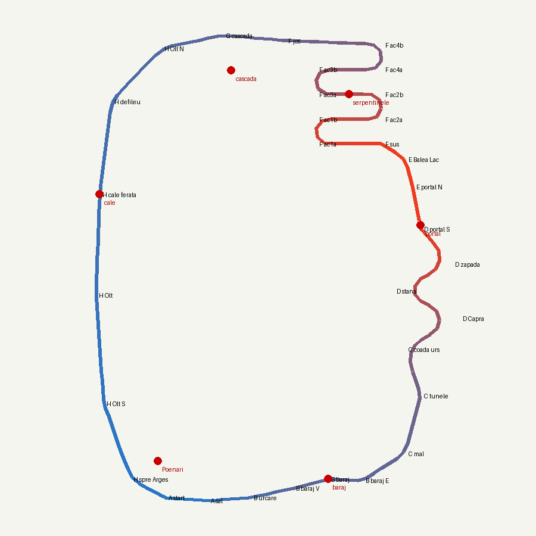

# Track brief — Transfăgărășan (`Track21`, temă `transfagarasan`) — v0.1 (concept)

> Concept de pistă, înaintea listei definitive de assets. Scheletul e cel din
> `okinawa.md` și `monument_valley.md`. Secțiunile de assets (§5) sunt un
> **audit al kitului alpin existent** plus o schiță a pieselor noi. Lista
> completă se scrie după ce traseul trece de ProbeLayout, de ProbeRace și de
> captura `--gamecam`.
>
> **A treia pistă care înlocuiește una existentă**, după Monument Valley
> (Dunele → Track19) și Okinawa (Track08 → Track20). Transfăgărășan ia locul
> lui `Track09` („Alpii”) pe **indexul 2**, prin același mecanism în doi pași
> (§7).
>
> **v0.1 (10 oct 2026), cererea dezvoltatorului:** „la fel cum am refăcut
> hărțile Dunele și Okinawa vreau să refacem harta Alpii. Trebuie să îi alegem
> un loc real din lume cu un biome muntos”. Candidații puși pe masă:
> Transfăgărășan, Stelvio + Dolomiții, Zermatt / Matterhorn. Alegerea
> dezvoltatorului: **Transfăgărășan**.
>
> **Ce e greșit la Track09 azi** (motivul refacerii, nu un gust):
> - e un **sat alpin generic**, ca Dunele și Okinawa veche: biserică, cabane,
>   vaci, telecabină, plug de zăpadă, toate „munte în general”, nu un loc;
> - arcul narativ (altitudinea: sat → pădure → culme → vale) e bun, dar
>   **niciun reper nu spune unde ești**: n-are un drum, un baraj, un lac sau
>   o siluetă pe care să le recunoști;
> - hazardele (carul cu fân, sania, vaca, plugul) sunt toate „ceva traversează
>   drumul”, iar `_hazard_fracs()` e gol din august: s-au pus de mână unde a
>   rămas loc, nu legate de o poveste.
>
> **Ce e diferit față de celelalte piste de munte.** Machu Picchu înseamnă
> *pădure de nori, terase verzi, piatră incașă*. Fiordland înseamnă *pereți
> uzi, verde închis, ploaie, apă neagră*. Cappadocia înseamnă *tuf moale,
> coșuri de zână, baloane*. Transfăgărășan înseamnă **drumul însuși: o
> panglică de asfalt care se pliază în ace de păr pe un versant golaș, deasupra
> pădurii, cu zăpadă pe margini în iulie, un lac glaciar sus și un baraj uriaș
> jos**. E singura pistă din joc al cărei reper principal e **șoseaua**.
> Diferența se verifică pe capturi puse alături (§6), nu se presupune.

## 0. Într-o propoziție

O după-amiază târzie de **la începutul lui iulie**, în prima săptămână după
ce s-a deschis drumul: jos e vară, sus e încă iarnă. Pornești din **valea
Argeșului**, cu **cetatea Poenari** pe colțul de stâncă din spatele tău, urci
spre **barajul Vidraru** și treci **pe coronamentul lui**, cu lacul la stânga
și hăul de 40 m la dreapta. Mergi pe **malul lacului**, prin **tunelurile
scurte săpate în stâncă**, iar la coada lacului **un urs a ieșit în drum**.
Urci prin **valea Caprei**, peste linia pădurii, printre jnepeni și stâne, și
ajungi între **pereții de zăpadă** de la portalul **tunelului Capra–Bâlea**,
unde **semaforul** hotărăște dacă intri acum sau aștepți. Ieși pe partea
cealaltă la **lacul Bâlea**, în căldarea glaciară, și de acolo **vezi sub tine
stiva de serpentine**: le cobori una câte una, cu **telecabina** trecând pe
deasupra și **o turmă de oi** care traversează un ac de păr mai jos. Intri în
**pădurea de molid de la Bâlea Cascadă**, cu cascada în trepte pe peretele
din stânga, și închizi bucla prin **defileul Oltului**, pe lângă râu și
**calea ferată**, unde **trenul** taie drumul la trecerea la nivel, înapoi
spre Poenari.

Singura pistă din joc în care **urci și cobori același munte**: o latură pe
asfalt cald de vale, una prin zăpadă, la peste +40 m.

## 0.1 Regula de artă (ce NU e pista asta)

**Nu „Alpi” generici** (cabane elvețiene cu balcoane sculptate, biserici cu
turle de ceapă tiroleze, vaci cu talangă pe pajiști de carte poștală,
Matterhorn pe fundal). **Nu „Transilvania lui Dracula”** (castele gotice cu
turnuri ascuțite, lilieci, ceață violet, lună plină). Ce trebuie să
recunoască jucătorul în 3 secunde: *„o șosea care se pliază în ace de păr pe
un versant verde-cenușiu fără copaci, cu zăpadă pe margini; un lac rece sus;
un zid de beton uriaș jos.”* Serpentinele văzute de sus sunt pentru
Transfăgărășan ce sunt Mittens-urile pentru Monument Valley.

Ce scoatem din Track09, cu motiv:
- **biserica alpină și cabanele de tip chalet** (`alpine_church`,
  `mountain_chalet_*`): arhitectură tiroleză. Pe Transfăgărășan vin
  **cabana de munte românească** (piatră jos, lemn sus, acoperiș abrupt de
  tablă sau șindrilă, ex. cabanele Bâlea Lac și Bâlea Cascadă), **stâna**
  (colibă joasă de lemn cu țarc) și **casele din Arefu / Corbeni** în vale;
- **vacile pe drum**: rămân doar ca decor în vale (sus sunt oile);
- **sania cu bușteni și plugul de zăpadă** ca hazarde: plugul poate rămâne
  **parcat** la portalul tunelului, ca decor real (drumul se deszăpezește în
  iunie);
- **calea ferată de culme**: pe creasta Făgărașului nu e tren. Trenul coboară
  **în defileul Oltului**, unde chiar există (§3);
- **muntele central rotund**: creasta Făgărașului e **lungă, zimțată, de
  șisturi cenușii-verzui**, cu căldări glaciare, nu un pisc izolat.

| pondere | strat |
|---|---|
| **35%** | drumul și lucrările lui: **asfaltul în ace de păr**, zidurile de sprijin din piatră, **parapetele de beton alb-roșu** la curbe, **viaductele** cu piloni, **portalurile tunelurilor**, **coronamentul barajului**, semnele de drum fără text, stâlpii de zăpadă alb-roșii |
| **25%** | muntele: **șisturi cristaline cenușii-verzui** (cu sclipire de mică), grohotișuri în conuri, căldarea glaciară, **pereții de zăpadă** de 3–5 m la margine sus, petice de zăpadă pe versantul nordic, lacul Bâlea și lacul Vidraru |
| **20%** | vegetația pe etaje: **pădure de fag** jos (Argeș), **molid** dens la mijloc (Bâlea Cascadă), **jneapăn** (tufe joase, culcate) peste linia pădurii, **pajiște alpină** cu **bujor de munte** (rododendron magenta, înflorit în iulie) |
| **10%** | cerul și apa: cer limpede sus, **mare de nori** în văile din depărtare, cascada în trepte, râul Olt lat și verde-cenușiu |
| **10%** | urmele omului, mărunte și reale: **stâne cu oi și câini ciobănești**, tarabe de lemn cu caș și afine la Bâlea, mașini parcate la belvedere, motociclete, **statuia lui Prometeu** la baraj, căsuțe de pază, stâlpi de electricitate în vale |

Trei acte pe un tur, **aceeași paletă, altă proporție**:
- **sudul** (Argeș, baraj, lac, pădure de fag: verde cald, beton, apă
  verde-închisă);
- **creasta** (Capra, zăpadă, tunel, Bâlea Lac, serpentine: cenușiu, alb,
  verde-iarbă rece, cer mare);
- **nordul și Oltul** (molid, cascadă, defileu, râu, cale ferată: verde
  închis, umbră, apă).

Nu trei palete.

## 1. Referința reală (ce luăm din fiecare loc)

Transfăgărășan-dioramă: **fiecare reper există**, dar drumul real are ~90 km
de la Vidraru la Cârțișoara. Compresia e declarată, ca la Okinawa (insula
compusă) și la Monument Valley (arcul). **Bucla însăși e reală**: turul
Sibiu → Transfăgărășan → Curtea de Argeș → Valea Oltului → Sibiu e circuitul
clasic al celor care vin pentru drum. Pista îl strânge într-o buclă de 2 km
în jurul crestei.

| loc real | ce luăm |
|---|---|
| **Valea Argeșului, Arefu / Căpățânenii** (case cu acoperiș de tablă, garduri de lemn, livezi) | **POI A**: startul în vale, la poalele cetății, satul de pe marginea drumului |
| **Cetatea Poenari**: ruina de pe vârful de stâncă de deasupra Argeșului, cu **1 480 de trepte** până la ea | **reper de fundal pe latura H și la start**: zidurile de cărămidă și piatră pe colțul de stâncă. **Fără Dracula** (§8) |
| **Barajul Vidraru** (1966): baraj-arc de **166 m** înălțime și **305 m** pe coronament, cu drumul pe el. **Statuia lui Prometeu**, cu fulgerul în mână, pe stânca de lângă | **POI B**: urci la baraj și **treci pe coronament**, cu lacul la stânga și hăul cu centrala jos la dreapta. Prometeu pe pinten. **Scara e decizie**: hăul are ~40 m în joc (§2.0) |
| **Lacul Vidraru** și drumul de pe malul lui, cu **tuneluri scurte** prin pintenii de stâncă și viaducte peste brațele lacului | **POI C**: mal, 1–2 tuneluri scurte, **ursul** la coada lacului (§3) |
| **Urșii de pe Transfăgărășan**: urși bruni care ies la marginea drumului, pe latura de sud, fiindcă oamenii îi hrănesc | **hazardul unic al pistei** (§3), cu regulă de respect (§8: **nu-i hrănim**) |
| **Valea Caprei**, cu stânele de pe pajiști și **lacul Capra** sub creastă | **POI D**: urcarea peste linia pădurii, jnepeni, stâna, apoi pereții de zăpadă |
| **Tunelul Capra–Bâlea**: ~890 m, la **2 042 m**, cel mai înalt punct al drumului, iar la începutul lui iulie portalul e încă între **pereți de zăpadă** | **POI D, finalul**: portalul de beton între pereții albi, **semaforul** (§3). În joc tunelul are ~60 m |
| **Lacul Bâlea**: lac glaciar la ~2 040 m, lung de 360 m, în căldare, cu **cabana Bâlea Lac** pe mal | **POI E**: ieși din tunel la lac, ocolești malul, cabana, tarabele, mașinile parcate |
| **Serpentinele nordice**: imaginea faimoasă, cu șoseaua pliată pe versantul golaș, viaducte și ziduri de sprijin, văzută de sus | **POI F**: **patru ace de păr stivuite**, coborâte unul câte unul. Pista e construită ca să le vezi **de sus, în parbriz** (§2.0) |
| **Telecabina Bâlea Cascadă – Bâlea Lac** (singura cale de acces iarna) | **teatru peste F**: cablul trece deasupra serpentinelor, cu cabinele în mers |
| **Cascada Bâlea**: ~68 m, în trepte, în pădurea de molid, lângă **cabana Bâlea Cascadă** și stația de jos a telecabinei | **POI G**: pădurea de molid, cascada pe peretele din stânga, stația de jos |
| **Defileul Oltului** (Turnu Roșu – Cozia): râul taie Carpații la vest de Făgăraș, cu **șoseaua și calea ferată** pe maluri | **POI H**: drumul pe lângă râu, pereți de stâncă împădurită, **trecerea la nivel**, unde trece trenul (§3) |
| **Creasta Făgărașului** (Moldoveanu 2 544 m, Negoiu 2 535 m), cu căldări glaciare și zimți | **interiorul buclei și fundalul**: creasta e muntele din mijlocul buclei, iar pe inelul de nord, depărtat, **Țara Făgărașului** (câmpie verde) |

**Culorile locului** (de măsurat pe fotografii la construcția temei, nu
copiate):
- șisturile cristaline: cenușiu-verzui (`#7E8478`), mai deschis pe fețele
  bătute de soare (`#A3A796`), închis în fisuri (`#4A4E47`);
- zăpada de iulie: alb murdar, granulat (`#E8ECEE`), umbră albăstruie
  (`#B5C3D3`), cu dungi de praf (`#B9B2A4`);
- pajiștea alpină: verde rece, scurt (`#7D9A4E`), cu **bujor de munte**
  magenta (`#B63A7A`);
- jneapănul: verde închis albăstrui (`#34503A`); molidul: verde-negru
  (`#23392B`); fagul: verde cald (`#5E8A3A`);
- lacul Bâlea: albastru-verzui rece, transparent la mal (`#3F6F7A`); lacul
  Vidraru: verde-închis (`#2F5446`); Oltul: verde-cenușiu tulbure (`#6E7F69`);
- betonul barajului și al portalurilor: gri cald (`#B8B4AA`);
- parapetele: alb (`#EEEEEA`) cu dungi roșii (`#C2312B`); stâlpii de zăpadă
  alb-roșii;
- asfaltul: gri-albăstrui, **linie albă**, nu galbenă.

**Lumina:** soare de după-amiază târzie, din **VNV** (~25°), cald-auriu.
Versantul nordic al crestei e în **contralumină parțială**: serpentinele
strălucesc ca panglici, zăpada are muchia aprinsă, iar umbrele de pe zăpadă
sunt albastre. Asta e identitatea luminii: **zăpada caldă în soare, rece în
umbră**, pe același cadru.

## 2.0 Verificarea cu camera (de ce reperele stau unde stau)

`ChaseCamera`: **10 m sus, 12,5 m în spate, 28,7° în jos, FOV 68°** (memoria
`verifica-cu-parametrii-lui`). Marginea de sus a cadrului e la **+5,25°**,
deci la distanța `d` camera vede cel mult **10 + 0,092·d** m peste cota
drumului. Jumătatea de cadru lateral e **~50°**. Fiecare reper e verificat pe
**patru axe**: distanță, verticală, **azimut** și **ocluzie** (memoria
`reperul-se-vede-pe-patru-axe`).

Tabelul de mai jos e măsurat pe schiță (§2.1, `fillet` + pas 12 m, aceleași
funcții ca `gen_okinawa_route.py`), **fără ocluzie**. Ocluzia (creasta,
pinteni, molizi) se măsoară pe `Track21` cu
`tools/transfagarasan_frustum_table.py`, înainte de decor:

| reper | de unde | poziția (hartă) | vârful (cotă) | în cadru (≤ 50°) | întreg sub marginea de sus |
|---|---|---|---|---|---|
| barajul (coronamentul) | startul A (0,00 → 0,08) | (95, −238) | +12 (drumul pe el) | **15/15** | **15/15**, la 45–211 m |
| portalul tunelului | urcarea D (0,25 → 0,31) | (215, 90) | +50 (portal + pereți) | 9/12 | 5/12 (ultimii metri: intri în el, corect) |
| **stiva de serpentine** | lacul Bâlea E (0,33 → 0,37) | (122, 259) | +37 → +19 (**sub** tine) | **8/8** | **8/8**, la 86–165 m, **privită de sus** |
| cascada | ultima serpentină → G (0,57 → 0,65) | (−30, 290) | +40 | 13/15 | 4/15 (o vezi întreagă doar de departe; de aproape vezi treptele de jos) |
| trecerea la nivel | defileul H (0,70 → 0,76) | (−200, 130) | trenul +8 | **12/12** | **12/12**, la 83–204 m |
| cetatea Poenari | sfârșitul lui H (0,84 → 0,94) | (−125, −215) | +28 (stânca +18, zidurile 10 m) | **19/19** | 9/19 (întreagă de la ~190 m) |

Consecințele, scrise ca intenție:
- **Serpentinele sunt dezvăluirea.** Toată pista e orientată ca momentul în
  care ieși din tunel la lacul Bâlea să-ți pună **stiva de ace de păr sub
  tine, în parbriz**. Camera e înclinată 28,7° în jos, deci ce e **sub**
  drum se vede, iar ce e deasupra nu. Coborârea e direcția în care camera
  arată imaginea faimoasă. De aceea pista **urcă pe sud și coboară pe nord**,
  invers decât ar fi „natural” pe hartă.
- **Fiecare ac de păr e turn de control pentru cel de sub el.** Oile (§3)
  traversează **o serpentină mai jos**: le vezi de pe ramura de deasupra cu
  ~6 s înainte, ca pe vaporul de la Okinawa văzut de pe cornișă.
- **Barajul e primul cadru.** Startul A merge spre E, cu barajul drept în
  față. Coronamentul se vede întreg pe toată valea.
- **Poenari e ultimul cadru.** Cetatea închide turul: o ai în stânga-față pe
  ultima dreaptă a Oltului, apoi treci pe sub stânca ei la start.
- **Creasta din mijloc nu e fundal** (memoria `munte-flanc-nu-fundal`): e
  **flancul** care se simte pe stânga pe toată urcarea D și pe toată
  coborârea F, la < 40 m. Vârful Moldoveanu ca atare nu intră în cadru de
  nicăieri și nu trebuie: creasta se citește ca perete, nu ca pisc.
- **Fundalul:** creasta de est (Negoiu, zimții) și câmpia Făgărașului pe
  inel, la **200–340 m**, sub `fog_end`, sub `FAR_PLANE` (380), cu
  **`cast_shadow` OFF** (memoriile `efecte-de-fundal-cote-legate`,
  `caster-departat-fura-umbra`).

## 2. Traseul și punctele de interes (POI)

Lungime **~2 150 m** (tur ~70–75 s, 3 tururi ≈ 3:40), în fereastra Ignition
65–80 s din `ref_notes/sisteme.md`. Track09 are 1 786 m.

**Sens antiorar pe plan.** Creasta stă în mijlocul buclei, de la vest la est.
Latura de **sud** e valea Argeșului (A, B). Latura de **est** e
Transfăgărășanul propriu-zis: urcarea pe sud (C, D), tunelul prin creastă
și coborârea pe nord (E, F). Latura de **nord** e pădurea de la Bâlea
Cascadă (G). Latura de **vest** e defileul Oltului (H), care ocolește capătul
crestei și închide bucla.

- A spre E, pe latura de sud (valea Argeșului, satul);
- B spre E, urcarea la baraj și **coronamentul**;
- C spre N, malul lacului Vidraru;
- D spre N, valea Caprei, în zigzag larg, până la portal;
- E spre N, tunelul, apoi lacul Bâlea;
- F spre N, **patru ace de păr** (ramuri V–E–V–E–V);
- G spre V, pădurea de molid, cascada;
- H spre S, defileul Oltului, înapoi la A.

| POI | fracții | cote | lățime (semi) | ce e |
|---|---|---|---|---|
| **A** valea Argeșului | 0,97 → 0,06 | 0 → +7 | 7 | startul, satul, cetatea Poenari în spate pe stâncă, barajul în față |
| **B** barajul | 0,06 → 0,15 | +7 → +13 | **6** pe coronament | urcare scurtă, apoi **coronamentul** (0,077 → 0,122): lacul la stânga, hăul la dreapta, parapete; Prometeu pe pinten |
| **C** lacul Vidraru | 0,15 → 0,24 | +13 → +20 | 7 | malul, **tunelurile scurte** prin pinteni (~0,17), **ursul** spre coada lacului (~0,20) |
| **D** valea Caprei | 0,24 → 0,32 | +20 → +42 | 7 | zigzag larg peste linia pădurii, jnepeni, **stâna**, pereții de zăpadă, **portalul cu semafor** (~0,315) |
| **E** tunelul și lacul Bâlea | 0,32 → 0,37 | +42 → +43 | **6** în tunel | tunelul (~60 m), ieșirea la lac, cabana, tarabele, **dezvăluirea serpentinelor** |
| **F** serpentinele | 0,37 → 0,62 | +43 → +14 | 7 | **patru ace de păr** (rază 16 m), ziduri de sprijin, viaduct scurt, telecabina pe deasupra, **oile pe ramura a treia** (~0,49) |
| **G** Bâlea Cascadă | 0,62 → 0,70 | +14 → +9 | 7 | pădure de molid, **cascada** în stânga, stația de jos a telecabinei, **săritura peste pârâu** (§3.1.3) |
| **H** defileul Oltului | 0,70 → 0,97 | +9 → 0 | 7 | râul pe dreapta, calea ferată pe malul celălalt, **trecerea la nivel** (~0,80), Poenari în stânga-față la final |

**Schița măsurată** (10 oct 2026, funcțiile geometrice din
`gen_okinawa_route.py`: fillet-uri pe arc, pas 12 m):
- **2 148 m**, sens antiorar;
- rază minimă **15,5 m** (acele de păr F; peste pragul de ~14 m de la care
  AI-ul începe să se opintească, lecția V-ului Strâmtorii din `track09.gd`);
- pantă maximă **11,9%** (urcarea D, între stână și pereții de zăpadă);
- separare minimă **32,2 m** (între două ramuri de serpentină: 18 m de
  margine la margine, peste `2 × half_width`; memoria
  `dunele-hairpin-pileup`);
- centroid la (25, 60), Cebîșev **326 m** (zidul lumii e la 420; memoria
  `ziduri-invizibile-ale-lumii`).

| porțiune | cote | lungime | pantă |
|---|---|---|---|
| A → baraj | 0 → +12 | ~165 m | ~8–10% |
| coronamentul | +12 | ~95 m | 0 |
| malul C | +12 → +20 | ~200 m | ~4% |
| urcarea D | +20 → +42 | ~220 m | **12%** max |
| tunelul + Bâlea Lac | +42 → +43 | ~110 m | ~0 |
| serpentinele F | +43 → +14 | ~540 m | ~7–8% pe ramuri, **0 în acele de păr** |
| G + defileul H | +14 → 0 | ~800 m | ~2% |

**Acele de păr sunt plane**, iar panta e pe ramuri. Pe drumul real e la fel,
și e ce cere un viraj de 180° la 16 m: o pantă de 8% în ac ar înclina mașina
pe diagonală exact când grip-ul lateral e la limită.

**De măsurat cu ProbeLayout:** pantă < 13%, rază ≥ 9 m, apropiere de sine
≥ 20 m. Bucla stă la < 420 m de centroid.

```
   N ↑         [G] Bâlea Cascadă              F jos ◄────────────────┐ ac4
        ┌────── molizi, CASCADA ◄──────────────────────────────────┐ │
        │ [H]   (stânga, pe perete)            ┌──────────────────┘ ac3
        │ defileul                             └────────────────────┐ ac2  [F] SERPENTINELE
        │ Oltului                              ┌────── OILE ───────┘       telecabina deasupra
        │ râul pe dreapta                      └────────────────────┐ ac1
        │                                                F sus ◄──┘
        ● TRECEREA LA NIVEL (tren)                          ▲ [E] lacul Bâlea, cabana
        │                       CREASTA                     ║ TUNELUL Capra–Bâlea
        │                 (Făgăraș, în mijlocul buclei)     ● portal + SEMAFOR, pereți de zăpadă
        │                                                   ╲ [D] valea Caprei: stâna, jnepeni
        │                                                   ╱  (zigzag larg)
        │                                                   ╲
        │                                                   │ [C] lacul Vidraru (stânga)
        │                                         URSUL ●   │ tunelurile scurte
        │                                                   │
        ▼  ▲ Poenari (stânca)                              ╱
     [A] START ──► satul ──► urcarea ──► [B] CORONAMENTUL ─┘
       valea Argeșului                     lacul la stânga (N), hăul la dreapta (S)
```

### 2.1 Schița de waypoint-uri (sursa generatorului)



Coordonate de hartă: x est, y nord, metri. În Godot: `gx = x`, `gz = −y`
(convenția din `gen_kyoto_route.py`, **fără oglindire**). Coloanele sunt:
(x, y, rază de fillet, cotă, etichetă).

```python
WPTS = [
    (-115, -262, 0, 0.0, "A start"),        (-60, -266, 0, 2.0, "A sat"),
    (-5, -262, 30, 7.0, "B urcare"),        (50, -250, 0, 12.0, "B baraj V"),
    (95, -238, 0, 12.0, "B baraj"),         (140, -240, 0, 12.0, "B baraj E"),
    (195, -205, 30, 13.0, "C mal"),         (215, -130, 0, 16.0, "C tunele"),
    (195, -70, 30, 20.0, "C coada urs"),    (265, -30, 28, 25.5, "D Capra"),
    (180, 5, 25, 31.0, "D stana"),          (255, 40, 25, 37.0, "D zapada"),
    (215, 85, 0, 42.0, "D portal S"),       (205, 140, 0, 43.0, "E portal N"),
    (195, 175, 20, 43.0, "E Balea Lac"),    (165, 195, 0, 42.0, "F sus"),
    (80, 195, 16, 37.0, "F ac1a"),          (80, 227, 16, 37.0, "F ac1b"),
    (165, 227, 16, 31.0, "F ac2a"),         (165, 259, 16, 31.0, "F ac2b"),
    (80, 259, 16, 25.0, "F ac3a"),          (80, 291, 16, 25.0, "F ac3b"),
    (165, 291, 16, 19.0, "F ac4a"),         (165, 323, 16, 19.0, "F ac4b"),
    (40, 328, 0, 14.0, "F jos"),            (-40, 335, 30, 12.0, "G cascada"),
    (-120, 318, 40, 9.0, "H Olt N"),        (-185, 250, 40, 7.0, "H defileu"),
    (-200, 130, 0, 5.0, "H cale ferata"),   (-205, 0, 0, 3.0, "H Olt"),
    (-195, -140, 40, 1.5, "H Olt S"),       (-160, -238, 40, 0.5, "H spre Arges"),
]
```

Fiecare ac de păr e scris ca **două puncte cu fillet de 16 m** (90° + 90°),
nu ca un singur punct de 180° (memoria `viraje-stranse-puncte-pe-arc`:
Catmull-Rom strânge curba dacă virajul e un singur punct).

Repere fixe pentru garda de azimut (nu se derivă din traseu; memoria
`garda-circulara-propria-functie`): coronamentul (95, −238), portalul
(215, 90), centrul stivei de serpentine (122, 259), cascada (−30, 290),
trecerea la nivel (−200, 130), Poenari (−125, −215).

**Apa, relieful, hăul.**
- **Lacul Vidraru** e la **stânga** coronamentului și a malului C (nord /
  vest), la cota **+9** (3 m sub coronament). De verificat la fundație ce
  dă apă de lac pe o temă fără mare (`custom_lagoon` cere tema cu `water`;
  Track16 Fiordland și Track10 Baikal au lacuri), §7;
- **hăul de sub baraj** (dreapta, sud) coboară la **~−28** (40 m sub
  coronament), ca `custom_ravines` pe partea dreaptă, cu râul Argeș la fund.
  Peretele barajului e un GLB (§5), nu teren;
- **lacul Bâlea** e un ochi de apă în căldarea de la ieșirea din tunel (E), la
  +41, pe dreapta drumului;
- **creasta** din mijlocul buclei urcă la **~+90…+110** (jumătatea de vest,
  zimțată), iar peste tunel la **~+75**, ca să existe munte deasupra
  portalului. Relieful e `TerrainPeak` / `terrain_bluff` (Track09 are deja
  masivul central, memoria `track-terrain-canyon-system`);
- **Oltul** curge pe dreapta lui H (vest), ca `TrackChannel` fără săritură
  sau ca apă de râpă (`custom_ravine_water`), cu malul celălalt la ~40 m și
  calea ferată pe el.

## 3. Hazarduri și mecanici

Cererea a fost „hazarduri refolosite și/sau unice”. Răspunsul: **trei
refolosite, fiecare cu un rost real pe Transfăgărășan, și unul unic**.
Mecanicile vin toate din cod existent. Ce e nou e mic: un export de model,
un clip de telegraf și un GLB animat.

Acoperirea celor cinci clase din `ref_notes/sisteme.md` §3:

| clasă (Ignition) | aici |
|---|---|
| **teatru** | telecabina peste serpentine, cascada, mașini și motociclete parcate la Bâlea Lac, câinii ciobănești, corbii peste creastă, marea de nori din văile depărtate, trenul care trece prin defileu și când nu taie drumul |
| frecare | **pământul** de pe tăietura ciobanilor (§3.1.4), **pietrișul** de pe acostamentul serpentinelor, iarba de pe pajiști (45%) |
| **oprire** | **semaforul de la tunel** (stai sau riști pe contrasens), **trenul** la trecerea la nivel |
| sabotaj de control | **oile** (te încetinesc și te împing, în funcție de masă), **ursul** (obstacol greu care traversează) |
| **aruncare** | **săritura peste pârâul Bâlea** (§3.1.3), crestele din defileu, oile împinse de mașina grea |

| mecanică | pe scurt | ce cere în cod |
|---|---|---|
| **Ursul** (C, ~0,20) — **unic** | un urs brun stă pe acostament, la marginea pădurii de pe malul lacului. **Telegraful e ursul însuși**: se ridică în două labe (1,2 s), apoi traversează drumul cu pas greu și se oprește pe partea cealaltă. E obstacol **greu**: dacă dai în el, te oprești tu, nu el. Nu se rănește și nu cade, doar te împinge (§8) | **reuse** — `SlidingHazard` în modul `TRAVERSARE`, prin `HazardMarker kind = SLIDING` (0) cu `motion = 1` și `face_travel = true`, ca vaca din Track09 și caii din Track19. **Nou:** GLB-ul animat `brown_bear` (Idle / Walk / **Stand**), pe pipeline-ul vacii și al elefantului (memoria `asset-animat-pipeline`). **Mic, nou:** dacă modelul are clipul `Stand`, `SlidingHazard` îl joacă pe durata telegrafului (azi telegraful e doar o întârziere). Fără clip, comportamentul rămâne bit-identic pe celelalte piste |
| **Semaforul de la tunel** (D→E, ~0,315) | tunelul are o bandă închisă de **lucrări** (șantierul de pe drumul de munte: conuri, barieră, semafor de șantier). Pe roșu vine din față **utilajul de drumuri**, pe banda liberă. AI-ul așteaptă pe dreapta; jucătorul poate forța pe stânga, cu risc. Decizia: **aștepți sau ghicești dacă iese utilajul** | **reuse** — `TunnelSignalHazard`, ca **nod separat** sub `Hazarduri`, cu lampa copil (`HazardLamp`), ca `Track16.tscn:273`. **Nu** prin `HazardMarker`: `kind = SIGNAL` (13) n-are constructor (`track.gd:12012-12042` tratează doar 0–12). `bus_model` e deja export, deci utilajul nu cere cod (§3.1.2). `tunnel_length` se măsoară pe tunelul din schiță (~60 m, nu 150), iar `period` se reglează pe el (Fiordland are 47,5 s pe 150 m). Pereții tunelului vin din relief (`TerrainPeak`) + GLB de portal, nu din script |
| **Oile pe serpentine** (F, ~0,49) | o turmă coboară versantul **peste ramura a treia**, în pulsuri (`pulse_on` / `pulse_off`), cu un câine ciobănesc la câteva oi. **O vezi de pe ramura de deasupra**, de sus, cu ~6 s înainte. Oile sunt **ușoare**: mașina grea trece prin turmă și o împrăștie, cea ușoară e frânată și deviată. E principiul 1 (masa contează) aplicat pe un hazard | **reuse** — `HerdHazard`, ca **nod separat** cu `flow_dir` (în jos pe pantă, spre N) și `road_dir` (de-a lungul ramurii, V–E), ca „RaulDeGnu” din `Track14.tscn:104`. **Mic, nou:** modelele sunt azi constante (`WILDEBEEST_GLB` / `ZEBRA_GLB`, `herd_hazard.gd:63-64`) și devin exporturi (`animal_model`, `alt_model`) cu implicitul neschimbat, deci **Track14 rămâne bit-identic**. Pe Track21, `zebra_ratio` devine proporția de câini. Reglaje de pornire: `animal_mass` ~45 (gnu 200), `speed` ~2,5 (gnu 6,5), `spacing` ~1,4, `corridor_m` ~14 (un ac de păr, nu o câmpie) |
| **Trenul** (H, ~0,80) | trecere la nivel în defileul Oltului, cu bariere și lumini. Trenul vine de pe malul celălalt și **taie drumul în diagonală**, ca linia reală, care trece dintr-o parte în alta a râului | **reuse** — `TrainHazard`, ca **nod separat** cu `model_path` (ca PeruRail în `Track15.tscn:288`). **Nu** prin `HazardMarker kind = TRAIN`: acolo `_build_train(frac)` (`track.gd:12354`) ignoră modelul din marker. La fundație rămâne `vehicles/train.glb`; trenul românesc e piesă opțională de kit (§5) |
| **Săritura peste pârâu** (G, ~0,67) | podețul de lemn al pârâului Bâlea e luat de viitură, iar golul se sare la ieșirea din pădure. E săritura din Track09, mutată | **reuse** — `TrackChannel` cu `jump = true`, ca „ParaulVaii” din `Track09.tscn:139` (gap 22, depth 18; se reglează pe viteza de la ieșirea din serpentine, nu se copiază) |
| **Tăietura ciobanilor** (F) | scurtătură de pământ (§3.1.4) | **reuse** — `TrackBranch` cu `surface = DIRT_ROAD`, ca „scurtatura” din `Track09.tscn:186` |

**Ce NU e nou:** ursul ca mecanică, semaforul, turma, trenul, săritura,
scurtătura. **Nou în cod, mic:** exporturile de model din `HerdHazard` și
clipul de telegraf din `SlidingHazard`. **Nou ca asset:** ursul animat și
oaia. Identitatea vine din **loc + drum + patru hazarde care chiar se întâmplă
acolo**: urși la marginea drumului, șantiere cu semafor, turme pe serpentine
și trenul din defileu.

**Distanțe între hazardele cu ceas** (lecția din `track08.gd:267`: „două
hazarde cu ceas lipite nu produc două decizii, produc o loterie”):
urs 0,20 → semafor 0,315 = **~245 m**; semafor → oi 0,49 = **~375 m**;
oi → tren 0,80 = **~665 m** (săritura e la mijloc, fără ceas); tren → urs
(peste start) = **~860 m**. Respiro-ul e A–B (valea, barajul) și G–H
(pădurea, defileul): condus pur, săritura, dreptele Oltului.

### 3.1 Decizii pentru dezvoltator

1. **Numele de afișare.** „Transfăgărășan” e numele drumului (DN7C) și nu e
   marcă. **Recomandare: „Transfăgărășan”, cu diacritice.** UI-ul folosește
   fontul implicit din Godot, care ar trebui să aibă diacriticele românești;
   se verifică pe captura meniului la fundație. Recordurile sunt pe cheie
   `TRACK_NAMES`, deci cele ale Alpilor rămân orfane la swap. E corect,
   fiindcă e altă pistă.
2. **Ce vine din tunel pe roșu.** (a) **utilajul de drumuri**, care
   refolosește `vehicles/snowplow.glb` (5 × 2,2 × 2,3 m): e real în prima
   săptămână după deschidere și nu cere GLB nou; (b) un autocar de turiști,
   mai lung și mai amenințător, dar GLB nou și apropiat de identitatea
   Fiordland (autocarul din tunelul Homer). **Recomandare: (a)**, cu girofar
   portocaliu.
3. **Săritura.** Drumul real nu are săritură. Track09 are, iar principiile
   (CLAUDE.md, „definiția fun”) o cer. **Recomandare: da**, la podețul luat de
   viitură de la ieșirea din pădurea G (viiturile și alunecările chiar închid porțiuni din
   Transfăgărășan).
4. **Scurtătura: tăietura ciobanilor.** O potecă de pământ care taie **acul
   de păr 3**, coborând direct pe pajiște de pe ramura a treia pe a patra.
   Scurtează drumul cu ~50 m, dar e pământ (grip mai mic), e abruptă și
   **trece prin culoarul oilor**, deci nu e o scăpare gratuită. **De măsurat
   întâi**: între ramuri sunt 32 m pe orizontală și 6 m pe verticală, adică
   ~19% pantă pe linie dreaptă. Peste 15%, poteca devine **diagonală** (mai
   lungă, mai blândă) sau o **săritură controlată** de pe buza ramurii.
   **Recomandare: da**, după ProbeRace pe bucla fără ea, cu ținta de la
   Monument Valley (−25…35% lungime, +0,5…1,5 s).
5. **Un al cincilea hazard?** Candidați: **căderile de pietre din defileul
   Oltului** (`RockfallHazard` pe Path3D, real: drumul din defileu se închide
   des din cauza lor) sau **avalanșa** din Track09 (`AvalancheHazard`).
   **Recomandare: nu la v0.1.** Avalanșa în iulie nu e credibilă (zăpada e
   doar pe margini), iar patru hazarde cu ceas pe 2,1 km e densitatea lui
   Track09. Căderile de pietre revin în discuție după ProbeRace, dacă
   defileul se simte gol.
6. **Turma: `HerdHazard` sau `SlidingHazard`?** La Monument Valley caii au
   rămas pe `SlidingHazard`, ca `HerdHazard` să rămână identitatea
   Serengeti. Aici diferența e de scară: oi mici, albe și lente, pe un culoar
   de 14 m, nu un fluviu de gnu pe 24 m. Comportamentul de turmă
   (împrăștierea, masa) e chiar ce face oile credibile. **Recomandare:
   `HerdHazard`**, cu exporturile de model. Se verifică pe captură că nu
   citește „Serengeti”.

## 4. Paleta și lumina (fără slot nou)

**Nu există slot liber** (32 din 32; `docs/style_bible.md:48` e învechit și
încă listează 24–31 ca rezervă). Transfăgărășan se face din **sloturi
existente + clase noi pe dale existente** (memoriile
`slot-reutilizat-intre-piste`, `tenta-pe-clasa-partajata`): **fără** retentarea
claselor partajate, iar tenta doar întunecă, deci luminosul cere
`CLASS_LIFT`. Se măsoară **după remap**, în joc (memoria
`monocromia-se-masoara-dupa-remap`).

| rol | slot existent / clasă |
|---|---|
| șisturile (stâncă, grohotiș, creastă) | `ROCK_LIGHT` 3 + clasă nouă **`tf_schist`** pe dala `alpine_granite.png`, cu tentă verzuie (Alpii rămân pe `alpine_granite`, neatinsă). De comparat cu `wet_gneiss`, care e deja o tentă a aceleiași dale |
| fisurile, umbra stâncii | `ROCK_DARK` 4, în suprafețe mici |
| zăpada, pereții de zăpadă | `FOAM_WHITE` 22 (`SNOW_WHITE` e alias) + clasa `snow` |
| pajiștea, jneapănul, molidul, fagul | `ground_tint` pe temă; `TROPICAL_GREEN` 21 (fag), `LOG_DARK` 28 + clasa `pine_needles` (molid, jneapăn) |
| bujorul de munte | `FLAMINGO_PINK` 31, în puncte mici |
| lacul Bâlea (rece, transparent la mal) | `ICE_TURQUOISE` 24 / `ICE_DEEP` 25 (sloturile Baikal) |
| lacul Vidraru, Oltul | `SEA_DEEP` 18, cu tenta apei pe temă (verde-închis, nu albastru de mare) |
| betonul (barajul, portalurile, viaductele, parapetele) | `CONCRETE` 8 |
| dungile roșii de pe parapete, stâlpii de zăpadă | `KERB_RED` 7 |
| cărămida de la Poenari | `TILE_TERRACOTTA` 23 + `ROCK_DARK` 4 (zidurile de piatră) |
| acoperișurile de tablă (sat, cabane) | `PAINTED_METAL` 11, `RUST_METAL` 10 |
| lemnul (stâne, garduri, cabanele de sus) | `WOOD_WEATHERED` 9 |
| ursul | `LARCH_RUST` 27 / `LOG_DARK` 28 (de măsurat: să nu iasă „vacă maro”) |
| oile, câinii | `SAND_LIGHT` 0 (lâna, alb-crem, nu alb pur), `ROCK_DARK` 4 (capetele) |
| asfaltul | `ASPHALT` 5 + `ASPHALT_EDGE` 6, **linie albă** |

**Lumina:**
- **soarele:** ~25° din **VNV** (~290°), `#FFD9A8`, energie ~1,1. `exposure`
  **se măsoară**;
- **ambientul:** cer de altitudine, rece, ~`#B8CCE0` la 0,3. Umbrele de pe
  zăpadă trebuie să iasă **albastre**, iar cele din pădurea de molid
  **verzi-închise**, nu negre (memoria `umbra-fara-culoare-e-negru-mort`);
- **cerul:** albastru adânc sus (`#2F6FD0`, mai saturat decât pe Alpii: e aer
  de 2 000 m), alb-cald la orizont spre VNV;
- **ceața:** 140 → 370 m, ca la Alpii (legată de `FAR_PLANE` 380; memoria
  `efecte-de-fundal-cote-legate`), albăstruie, măsurată HSV față de
  `ground_tint` (memoria `ceata-in-familia-solului`). **Marea de nori** din
  văile depărtate e `horizon_model`, nu ceață;
- **umbrele:** pornite (`theme_shadows`), `shadow_distance` 90. Pereții de
  zăpadă și zidurile de sprijin au nevoie de umbra de contact (memoria
  `adancimea-cere-lumina-nu-doar-umbra`).

**Azimutul soarelui față de drum** (se remăsoară la fiecare redesenare,
memoria `azimutul-soarelui-fata-de-drum`):

| porțiune | direcție | soarele | ce dă |
|---|---|---|---|
| A–B | spre E | din spate | **barajul și satul luminate din față**: primul cadru arată bine |
| C–D | spre N | din stânga | lacul din stânga în contralumină (sclipește), versantul din dreapta luminat lateral |
| E | spre N | din stânga-față | zăpada de la portal cu muchia aprinsă, umbre albastre spre tine |
| F, ramurile spre V | spre V | **din față** | **serpentinele de sub tine strălucesc ca panglici**: imaginea faimoasă |
| F, ramurile spre E | spre E | din spate | pajiștea și oile luminate din față, se citesc bine |
| G | spre V | din față | **cascada în contralumină**: spray-ul strălucește pe pădurea închisă |
| H | spre S | din dreapta | malul de vest (dreapta, cu râul) în umbra defileului, peretele de est aprins |

## 5. Assets

Categoria nouă `assets/models/transfagarasan/`, cu subfolderele `buildings/`,
`structures/`, `rocks/`, `plants/`, `props/`, `animals/`, `vehicles/`,
`effects/` (memoria `assets-models-categorii`). Kitul alpin rămâne pe loc,
fiindcă Track09 îl folosește până la swap. Piesele refăcute sunt **fișiere
noi**, nu suprascrieri.

### 5.1 Auditul kitului alpin (ce refolosim, ce refacem)

Kitul alpin n-are document de kit în `docs/asset_briefs/`. Cotele de mai jos
vin din antetul scripturilor `tools/blender/build_alpine_*.py`. Ținta de scară
vine din cameră (memoria `inaltimea-obiectelor-si-camera`): un obiect de la
marginea drumului care trebuie **citit** cere ≥ 3–4 m, iar un reper care
trebuie **văzut de departe** cere ≥ 15 m.

| asset | azi | verdict | de ce |
|---|---|---|---|
| `trees/alpine_pines.glb` (Pine A–D, 5–13 m) | conifere conice | **păstrat ca molid** | molidul carpatin are exact silueta asta; pădurea G și malul C |
| `plants/alpine_shrub.glb` | 1,2 m | **de evaluat ca jneapăn** | jneapănul e o tufă joasă, culcată, în pâlcuri dese, verde-închis. Dacă tufa rotundă nu citește „jneapăn”, vine `jneapan` A/B |
| `flowers/flower_cluster.glb` | 0,6 m | **păstrat**, plus `bujor_de_munte` | bujorul e accentul magenta al pajiștii în iulie |
| `scatter/snow_patch.glb` | 5 × 5 × 0,2 m | **păstrat** | peticele de zăpadă de pe versantul nordic |
| `rocks/canyon_rocks.glb`, `rocks/rock_large.glb` | S/M/L | **păstrat, pe `tf_schist`** | grohotișul și blocurile; forma de șist (lame, nu bolovani rotunzi) vine din piesele noi |
| `rocks/mountain_peak.glb` | 100 × 80 × 80 m, `PeakSnow` | **păstrat ca bază de orizont**, plus `fagaras_ridge` | creasta Făgărașului e lungă și zimțată, nu un pisc izolat |
| `structures/cable_car_pylon.glb` | ~18 m | **păstrat**, de verificat pe fotografie | stâlpii telecabinei Bâlea sunt metalici; dacă diferă mult, se reface |
| `vehicles/cable_car_gondola.glb` | 2,3 × 2,1 × 4 m | **de evaluat, probabil refăcut mai mare** | cabinele de la Bâlea sunt mari, de zeci de persoane, nu gondole de 4 locuri. Pe deasupra serpentinelor, o cabină mare citește mai bine |
| `buildings/cable_car_station.glb` | 14 × 8 × 8 m | **păstrat**, de evaluat | stația de jos de la Bâlea Cascadă |
| `structures/stream_bridge.glb` | 18 × 5 × 3 m | **păstrat** | podețul de la săritura G (rupt) și podurile din defileu |
| `structures/mountain_tunnel.glb` | 18 × 15 × 12 m | **înlocuit** | portalul de la Bâlea e beton plat între pereți de zăpadă: `tunnel_portal_balea`. Tunelurile scurte de pe malul Vidraru sunt stâncă brută: `rock_tunnel_portal` |
| `vehicles/snowplow.glb` | 5 × 2,2 × 2,3 m | **păstrat** | utilajul din tunel (§3.1.2) și unul parcat la portal |
| `vehicles/hay_cart.glb`, `props/hay_bale.glb`, `props/wood_stack.glb` | 0,8–2,5 m | **păstrat, decor în sat** | căruța cu fân și stogurile sunt reale în valea Argeșului |
| `props/cow.glb` (animat) | 2,6 m | **păstrat, decor în vale** | vaci la marginea satului A, nu pe drum |
| `structures/wooden_fence.glb` | 1,2 m | **păstrat** | țarcurile stânelor, gardurile din sat |
| `signs/alpine_signpost.glb` | 1,8 m | **de evaluat** | semnele românești sunt altfel (pătrate albastre, triunghiuri); fără text oricum |
| `vehicles/train.glb` | — | **păstrat la fundație** | trenul din defileu; trenul românesc e opțional (§5.2) |
| `buildings/alpine_church.glb` | 14 m | **scos** | biserică tiroleză (§0.1); nicio biserică nouă (§8) |
| `buildings/mountain_chalet_large/small.glb` | 6,5–9 m | **scos** | chalet elvețian; vin `cabana_balea_lac`, `cabana_balea_cascada`, `stana`, `arges_house` |
| `vehicles/timber_sled.glb` | 5 m | **scos** | hazardul fără loc al Alpilor |
| `effects/avalanche_boulders.glb` | — | **nefolosit** | §3.1.5 |

### 5.2 Piese noi (schiță)

**Hero:**
- `vidraru_dam`: peretele-arc al barajului, ~40 m de la coronament la fund,
  modular pe lungime, cu parapetul și turnurile de pe coronament;
- `prometheus_statue`: ~9 m, pe pinten, cu fulgerul în mână, **fără text**;
- `poenari_ruin`: zidurile de cărămidă și piatră pe colțul de stâncă, ~10 m de
  zid peste o stâncă de ~18 m;
- `tunnel_portal_balea`: beton, cu pereții de zăpadă lipiți;
- `cabana_balea_lac`, `cabana_balea_cascada`;
- **`brown_bear`**, animat (Idle, Walk, Stand): ~2,2 m în patru labe, ~3 m
  ridicat, la scara de joc, nu la cea reală;
- **`sheep`** plus `sheepdog`, pentru MultiMesh-ul turmei.

**Kit:**
- drumul: `snow_wall` (modul de perete de zăpadă de 3–5 m, cu straturi și
  praf, lângă asfalt), `retaining_wall` (zid de sprijin din piatră, modul curb
  și drept, pentru acele de păr), `rock_tunnel_portal`, `snow_pole` (stâlp
  alb-roșu), `road_works` (conuri, barieră, semafor de șantier, indicator fără
  text), `level_crossing` (bariere, lumini, crucea Sf. Andrei **fără text**);
- clădiri: `stana` (colibă de lemn + țarc), `arges_house` A/B (casele din
  vale, cu acoperiș de tablă și prispă), `souvenir_stall` (taraba de lemn de
  la Bâlea, fără text);
- vehicule: `parked_car` A/B și `motorbike` (generice, fără mărci);
- stâncă: `schist_outcrop` A/B/C (lame de șist înclinate), `scree_cone`;
- plante: `jneapan` A/B, `beech_tree` A/B (fagul din valea Argeșului),
  `bujor_de_munte`, `afin` (tufă joasă).

**Opțional:** `ro_train` (locomotivă electrică + vagoane, culori generice,
**fără sigle**), `cable_cabin_large` (cabina mare a telecabinei).

**Fundal:** `fagaras_ridge` (creasta zimțată, cu zăpadă în căldări),
`cloud_sea` (fâșia de mare de nori din văi), `fagaras_plain` (câmpia verde,
joasă, de la nord).

### 5.3 Trecerea de contracte — **de făcut înainte de primul build**

Memoria `brief-cere-glb-cod-il-face-deja`: înainte de comanda de kit se
verifică ce face deja codul.
- **viaductele și parapetele** de pe serpentine: codul face viaduct pe râpe
  (`custom_ravines` + `_rail_segments`). Se verifică stilul de parapet
  (alb-roșu) înainte să se comande un GLB de parapet;
- **cascada** e `WaterfallVisual` procedural (Fiordland), nu GLB;
- **trestle-ul trenului** îl construiește `TrainHazard` singur, unde terenul
  coboară;
- **lampa semaforului** e `HazardLamp`; din kit vine doar recuzita de șantier;
- **lacurile și Oltul** sunt apă din cod (de lămurit cum, §7);
- **pereții tunelului** vin din relief (`TerrainPeak`); din kit vin doar
  portalurile;
- **turma** e MultiMesh: oaia e o singură piesă statică (gnu-ul și zebra din
  Serengeti sunt statice, memoria `serengeti-assets-kit`), nu animată.

## 6. Bugete

| buget | țintă | cum se măsoară |
|---|---|---|
| materiale | **≤ 30** (garda pică la 38) | `probe_decor --track=21` |
| triunghiuri | raportate, fără plafon (CLAUDE.md) | `probe_decor` |
| timp de încărcare | ≤ Track19 + 0,5 s, **cu fereastră** | `probe_load_time` (memoria `headless-ascunde-citirea-de-pe-gpu`) |
| vegetația în masă | molizii, fagii și jnepenii pe **MultiMesh** peste ~1 000 de piese | memoria `decor-in-masa-cere-multimesh` |
| particule | spray-ul cascadei, praful de pe tăietura ciobanilor, cu limită de count | `probe_fx` |
| ProbeRace | 8 mașini, 16 seed-uri: **0 ieșiri din lume**, `[blocaj]` = 0 în acele de păr și în tunel, repuneri doar la săritură | memoria `zero-repuneri-ascunde-blocajul` |

## 7. Ordinea de construcție

1. **Brief v0.1** (acest document). PR propriu.
2. **Fundația `Track21.tscn`** din `tools/gen_transfagarasan_route.py` (copie
   de `gen_okinawa_route.py`):
   - garda de **sens** inversată (Okinawa cere ORAR, aici bucla e ANTIORARĂ);
   - garda de azimut scrisă **înaintea** traseului, pe reperele fixe din §2.1
     (barajul din A, portalul din D, serpentinele din E, cascada din F–G,
     trecerea la nivel și Poenari din H), plus `--sabotaj`, care trebuie să
     pice;
   - tema **`transfagarasan`** în `Track.themes()` (pornind de la `alpine`,
     **fără** să o editeze), cheia în enum-ul din `track_from_path.gd` și
     `info/Track21.tres` (regiunea „EUROPA”; accentul e de ales, propunerea e
     verde-cenușiu de șist, `(0.42, 0.52, 0.46)`);
   - `custom_name` și `custom_world_seed_name` **înghețate** de la prima
     generare;
   - pe traseu: `custom_width_segments` (coronamentul și tunelul la 6),
     `custom_ravines` (hăul barajului pe dreapta, viaductele de pe
     serpentine), `TrackChannel` cu `jump = true` (G), `TerrainPeak` pentru
     creastă (Track09 are tiparul: „MasivCentral”, „UmarulDeSud”), noduri
     `TunnelSignalHazard`, `HerdHazard` și `TrainHazard`, plus un
     `HazardMarker` SLIDING pentru urs, cu vaca drept model provizoriu.
     Portaluri și ziduri **provizorii** din kitul alpin în `DecorManual`, ca
     să se vadă scara;
   - **de lămurit la fundație: apa fără mare.** Tema `alpine` are
     `water = false`. Lacurile (Vidraru, Bâlea) și Oltul cer apă de lac sau de
     râpă. Tiparul e Fiordland (Track16) sau Baikal (Track10), nu marea de
     insulă;
   - **exporturile din `HerdHazard`** (`animal_model`, `alt_model`), cu
     implicitul neschimbat (Track14 bit-identic), și **clipul `Stand`** din
     `SlidingHazard`, opțional pe model;
   - `GameState`: Track21 **la coada listei** (indexul 14). Alpii rămân pe
     indexul 2 până la swap. Toate uneltele o adresează cu `--track=21`
     (`resolve_track_index`).
3. **Gărzi:**
   - `ProbeLayout --track=21`, `ProbeBuried`;
   - `ProbeLaneClear`, cu linie de bază „… (Track21)” fără marjă + `--sabotaj`
     care pică;
   - `ProbeCameraSolid` pe tunel, portaluri și pereții de zăpadă (memoria
     `camera-zone-tavan-per-sala`);
   - pe Track21: `probe_fiord_semafor` / `probe_tunel`, `probe_herd_coverage`
     și sonda de traversare pentru urs (`probe_crossing`).
4. **ProbeRace la început**: 8 mașini, 16 seed-uri. Se citesc `[blocaj]` /
   lent / invers / carusel, nu doar repunerile. Locul de urmărit sunt acele
   de păr: raza de 16 m e aproape de pragul de ~14 m al AI-ului.
5. **Tabelul de frustum cu ocluzie** (`tools/transfagarasan_frustum_table.py`):
   garda trebuie să pice pe o stare stricată. Întrebarea principală: se vede
   **stiva de serpentine de sub tine** de la ieșirea din tunel, sau o taie
   buza căldării?
6. **Verdictul dezvoltatorului la volan** pe fundație: se simte dezvăluirea
   serpentinelor? Acele de păr sunt fun sau doar lente? Se văd oile de pe
   ramura de deasupra? Semaforul e decizie, nu taxă? Ursul se citește urs?
7. **Planul real adnotat**:
   - captura `Snapshot.tscn -- --track=21 --no-fog`, **cu fereastră**
     (memoria `snapshot-nu-merge-headless`), adnotată cu
     `tools/annotate_transfagarasan_plan.py` (tiparul
     `annotate_okinawa_plan.py`);
   - **prompturile ChatGPT v0.2 (§9)** → dioramă + planșă de inventar;
   - kit Blender (`docs/asset_briefs/transfagarasan_kit.md`,
     `tools/blender/verify_transfagarasan.sh`) → integrare → POI A–H (gauntlet,
     valuri de 3).
8. **Commit-ul de swap**, după decor și după al doilea verdict la volan:
   - Track21 pe indexul 2, Track09 scos din `TRACK_SCENES` / `TRACK_NAMES`;
   - **Track09 rămâne în repo**, ca banc de test. Sondele care îl încarcă
     (`probe_track09_fracs`, `probe_alpine_terrain`, `probe_avalanche`,
     `probe_avalanche_terrain`, `probe_decor`, `probe_lane_clear`,
     `probe_manual`, `verify_all_tracks_load`) trec **pe cale** sau pe
     `--track=21`;
   - gărzile cu cheia „Alpii (Track09)” se mută.

## 8. Lecții aplicate anticipat, și ce a fost respins

- **Patru axe, scrise înaintea traseului.** Sensul buclei (urcare pe sud,
  coborâre pe nord) e **derivat** din cameră (§2.0): serpentinele se văd doar
  de sus.
- **Acele de păr sunt plane**, iar panta e pe ramuri (§2). Fiecare ac e scris
  ca două puncte de 90° (memoria `viraje-stranse-puncte-pe-arc`). Benzile
  sunt la 32 m, deci 18 m de margine la margine (memoria
  `dunele-hairpin-pileup`).
- **Scara e decizie.** Hăul barajului are 40 m, nu 166. Tunelul are 60 m, nu
  890. Cascada are ~28 m vizibili, nu 68. Poenari are 28 m, nu 1 480 de
  trepte.
- **Hazardele cu ceas la ≥ 200 m unul de altul** (§3).
- **Coada de AI de la semafor se măsoară pe pista reală** (memoria
  `harnas-sintetic-comportament-emergent`), cu regula de frânare din
  Fiordland (memoria `franare-de-coada-blocaj-reciproc`).
- **Utilajul din tunel se măsoară pe ax** înainte de ProbeRace (memoria
  `hazard-dezaliniat-contamineaza-verdictul`: autocarul din Fiordland mergea
  la 8 m de drum).
- **Ceasurile pornesc în prima fază** (memoria
  `ceasul-porneste-in-prima-faza`): semaforul, turma și trenul se verifică
  și la `t = 0`, nu doar în regim.
- **Unealta de captură înainte de captură** (memoria
  `unealta-de-captura-e-parte-din-masuratoare`): `Snapshot` are nevoie de
  faze forțate pentru ursul ridicat, turma pe drum, trenul pe trecere și roșul
  de la semafor. Ce lipsește intră **odată cu fundația**.
- **Diorama din geometria reală** (memoria `diorama-din-geometria-reala`):
  prompturile se scriu pe captura reală a lui Track21, nu pe schița de aici.
- **Respectul e regulă de design:**
  - **ursul nu e hrănit, nu e rănit și nu e lovit „ca să sară”.** Hrănitul
    urșilor de pe Transfăgărășan e o problemă reală: urșii obișnuiți cu
    mâncarea de la oameni ajung să fie eutanasiați. În joc, ursul
    **traversează și pleacă**, iar contactul te oprește pe tine. Detaliul
    corect e un indicator cu **pictograma** „nu hrăniți urșii” (fără text) la
    coada lacului;
  - **fără Dracula**: fără țepe, lilieci, sânge, castel gotic sau „Vlad”.
    Poenari e o ruină pe o stâncă, atât;
  - **fără simboluri politice**: drumul a fost construit de armată în
    1970–1974, la ordinul regimului comunist. Nimic din asta în decor;
  - **fără locuri religioase**: fără mănăstiri (Cozia e în defileul Oltului),
    biserici sau troițe. E aceeași regulă ca la Okinawa (fără *utaki*).
- **Legal și nume:**
  - fără mărci: fără Dacia, CFR, Top Gear, branduri de bere sau de caș pe
    tarabe; mașinile parcate sunt generice;
  - în UI apare doar „Transfăgărășan” (numele drumului); „Bâlea”, „Vidraru”
    și „Poenari” **nu** apar;
  - semnele de drum și indicatoarele sunt **fără text lizibil**.
- **Respins, cu motiv:**
  - **Zermatt / Matterhorn** și **Stelvio + Dolomiții**: candidații care n-au
    fost aleși (decizia dezvoltatorului, 10 oct 2026);
  - **urcarea pe nord** (sensul „natural” Sibiu → Bâlea): serpentinele ar fi
    deasupra ta, adică în afara cadrului (§2.0);
  - **avalanșa și sania** din Track09 (§3.1.5, §0.1);
  - **hotelul de gheață** de la Bâlea Lac: există doar iarna, iar pista e în
    iulie;
  - **calea ferată de culme** din Track09: pe creasta Făgărașului nu e tren;
  - **doar Transfăgărășanul, fără Olt**: drumul real nu e buclă, iar o buclă
    inventată ar fi mai puțin adevărată decât cea pe care chiar o fac
    oamenii.

## 9. Prompturile ChatGPT (dioramă + planșă de inventar)

Se scriu în **v0.2**, pe **planul real adnotat** al fundației Track21 (§7,
pasul 7), nu pe schița de aici. Tiparul e `okinawa.md` §9 / §9.1:
- „ONE CLOSED LOOP” ca prim paragraf;
- densitatea pe cifre;
- hazardele surprinse în cadru: ursul ridicat, turma pe ramura a treia,
  utilajul ieșind din tunel, trenul pe trecere;
- camera din colțul de **SE**, fiindcă serpentinele și barajul sunt pe latura
  de est;
- lista FORBIDDEN din §8.

## Istoric

- **v0.1 (10 oct 2026):** concept. Alpii refăcuți ca Monument Valley și
  Okinawa: `Track21` nou, temă `transfagarasan`, traseu redesenat de la zero
  (~2 150 m, măsurat pe schiță), care înlocuiește Track09 pe indexul 2 după
  decor. Locul e compus pe bucla reală Transfăgărășan + Valea Oltului:
  Poenari, Vidraru, Capra, tunelul, Bâlea Lac, serpentinele nordice, Bâlea
  Cascadă, defileul. Hazardele:
  - **ursul** (unic, `SlidingHazard` + GLB animat);
  - **semaforul de șantier din tunel** (`TunnelSignalHazard`);
  - **oile pe serpentine** (`HerdHazard` cu model exportat);
  - **trenul** (`TrainHazard`);
  - plus săritura și scurtătura moștenite.

  Auditul kitului alpin: 19 piese păstrate (5 dintre ele de evaluat), 1
  înlocuită, 4 scoase, 1 nefolosită, ~35 de piese noi.
